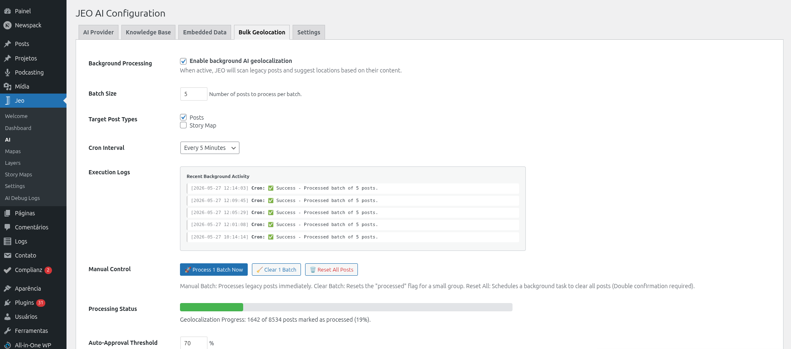
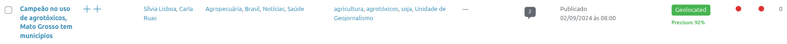
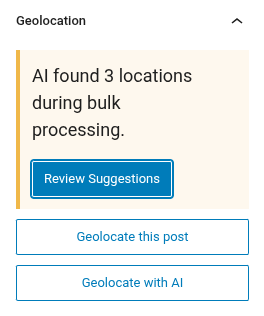
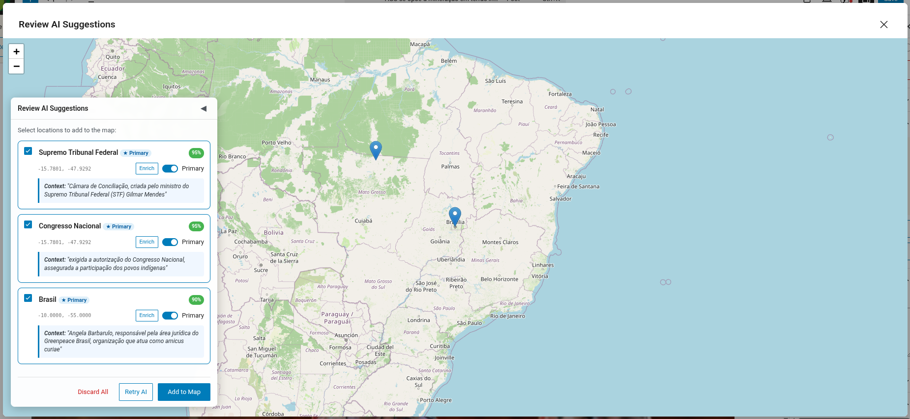

# Geolocalización masiva con IA

La Geolocalización masiva te permite georreferenciar muchas entradas a la vez con IA. Esto es útil cuando tienes un archivo grande de entradas que no fueron geolocalizadas al publicarse por primera vez.

## Cómo funciona

El sistema de Geolocalización masiva procesa las entradas por lotes usando el cron de WordPress (WP-Cron). Selecciona las entradas que no tienen datos de geolocalización (metadato `_related_point`) y las envía a la IA para su análisis.

## Configuración inicial

1. Configura un proveedor de IA en **Jeo → IA** (consulta [Configuraciones de IA](ai-settings.md)).
2. Ve a la pestaña **Geolocalización masiva** en **Jeo → IA**.
3. Selecciona los tipos de contenido a procesar, define el umbral de confianza y configura el tamaño del lote.
4. Inicia el proceso masivo.

## Procesamiento

Una vez iniciado, el sistema procesa las entradas en segundo plano:

- Cada lote selecciona entradas sin datos de geolocalización y las envía a la IA.
- Aparece una columna **Estado de IA de JEO** en la lista de entradas del panel de WordPress, que muestra el estado de georreferenciación de cada entrada.
- Las entradas procesadas se marcan para revisión — no se publican automáticamente.

## Revisar los resultados

Tras el procesamiento, puedes revisar la geolocalización sugerida por la IA para cada entrada:

1. Ve a la lista de entradas y busca las que tengan estado de IA "pendiente de revisión".
2. Haz clic en una entrada para abrir el editor.
3. La barra lateral Geolocalización mostrará los puntos sugeridos por la IA.
4. Aprueba o ajusta los puntos según sea necesario.

También puedes usar la **acción masiva** en la lista de entradas de WordPress (`edit.php`) para aprobar varias entradas a la vez. Selecciona las entradas, elige **Aprobar geolocalizaciones de IA de JEO** en el menú desplegable de acciones masivas, y aparecerá un modal de vista previa que muestra las ubicaciones sugeridas de cada entrada, sus puntuaciones de confianza y una acción de aprobar/rechazar.

## Monitoreo

- **Jeo → Registros de Debug de IA**: Consulta el uso de tokens, el proveedor y el modelo de cada llamada a la IA.
- La pestaña Geolocalización masiva muestra el progreso del lote actual y los errores encontrados.

## Requisitos

- Debe haber un proveedor de IA configurado.
- Las entradas deben tener título y/o contenido para que la IA pueda analizarlas.
