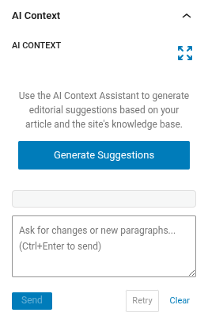
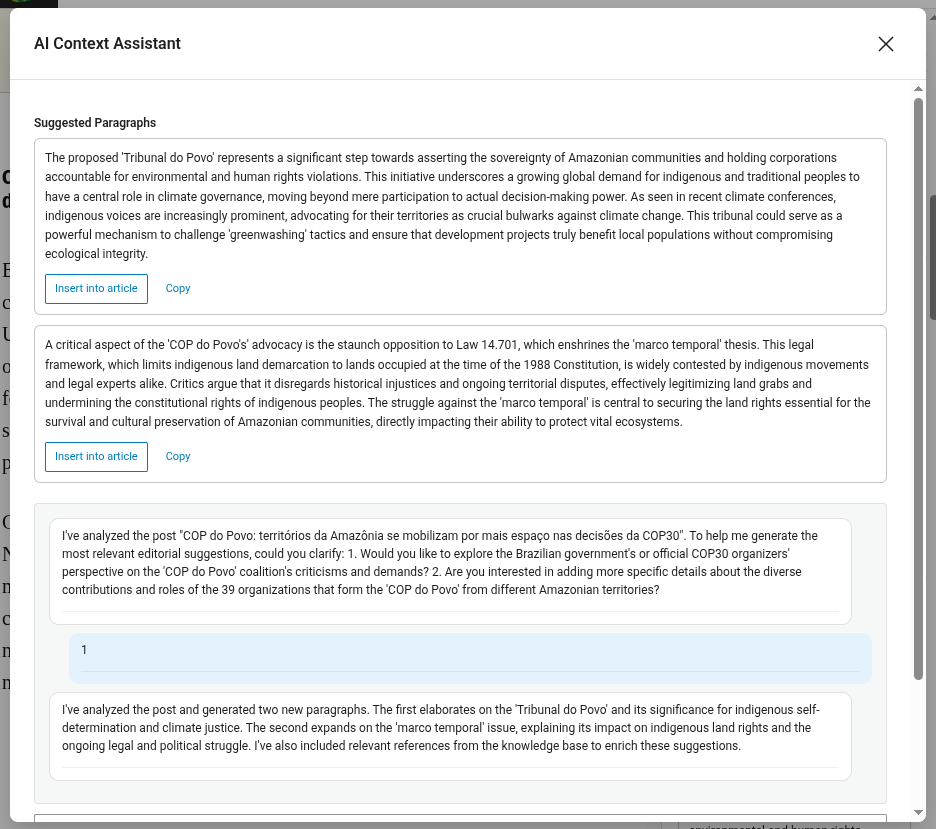

# Asistente de contexto de IA — Sugerencias editoriales

El Asistente de contexto de IA es un panel de la barra lateral de Gutenberg que te ayuda a enriquecer tus artículos con párrafos sugeridos por IA y referencias a contenido relacionado de la Base de conocimiento de tu sitio.

Consulta [IA en JEO](ai-in-jeo.md) para saber cómo RAG, los agentes y la memoria de conversación dan vida a esta funcionalidad.

## Abrir el panel

1. Abre o crea una entrada en el editor de Gutenberg (el tipo de contenido debe estar activado en **Configuraciones de JEO → General**).
2. En la barra lateral **Documento**, busca el panel **Contexto de IA**.
3. Si el panel está contraído, haz clic en su título para expandirlo.

## Generar sugerencias

Haz clic en **Generar sugerencias**. La IA analizará el contenido de tu artículo y el archivo vectorizado de artículos del sitio para producir:

- **Párrafos sugeridos** — bloques de texto listos para insertar que complementan tu artículo. Los párrafos pueden incluir formato en línea (negrita, cursiva) y enlaces a artículos relacionados.
- **Referencias relacionadas** — artículos de tu Base de conocimiento relevantes para el tema.

La generación **no es automática**: tú controlas cuándo se ejecuta para evitar llamadas innecesarias a la API.

## Usar los párrafos sugeridos

Cada párrafo sugerido tiene dos acciones:

### Insertar en el artículo

Haz clic en **Insertar en el artículo** para añadir el párrafo como un bloque `core/paragraph` de Gutenberg al final del documento. El formato en línea y los enlaces se conservan. Una vez insertado, el botón cambia a **Insertado** para evitar duplicados.

### Copiar

Haz clic en **Copiar** para copiar el párrafo como texto enriquecido (HTML con enlaces) al portapapeles. Después puedes pegarlo en cualquier parte: el editor de WordPress, Google Docs, Word, etc. La copia usa un mecanismo de triple fallback para máxima compatibilidad:

1. API moderna `ClipboardItem` (HTML + texto sin formato)
2. Selección DOM + `execCommand('copy')` (funciona en los iframes de Gutenberg)
3. Solo texto sin formato (fallback universal)

## Refinar con el chat

Tras la generación inicial, puedes refinar las sugerencias en el área de texto del chat:

- **"Hazlo más corto"** — condensa los párrafos sugeridos.
- **"Céntrate en el impacto ambiental"** — reescribe con un enfoque específico.
- **"Añade más contexto histórico"** — amplía con antecedentes adicionales.
- **"Incluye datos sobre la región amazónica"** — añade contenido específico de la región.

Pulsa **Ctrl+Enter** o haz clic en **Enviar** para enviar tu mensaje.

### Reintentar

Haz clic en **Reintentar** para pedir a la IA que genere nuevas sugerencias sin escribir un mensaje. Útil cuando quieres un enfoque distinto del mismo tema.

### Limpiar

Haz clic en **Limpiar** para restablecer toda la conversación y eliminar todas las sugerencias. Una conversación nueva empieza de cero con el siguiente clic en "Generar sugerencias".

## Expandir el panel

Haz clic en el botón **expandir** (esquina superior derecha del panel) para abrir la interfaz de chat en un modal más grande. Esto ofrece una mejor experiencia para conversaciones largas. El modal comparte el mismo estado que el panel compacto.

## Persistencia

Tu conversación se guarda automáticamente. Si cierras el panel, actualizas la página o vuelves a abrir el editor más tarde, tu historial de chat y tus últimas sugerencias se restauran.

## Personalizar el prompt de IA

Por defecto, el Asistente de contexto usa un prompt del sistema integrado, optimizado para sugerencias editoriales. Puedes personalizarlo:

1. Ve a la pestaña **JEO → IA → Asistente de contexto**.
2. Marca **"Usar un prompt del sistema personalizado"**.
3. Edita el prompt en el área de texto.
4. Guarda las configuraciones.

Cuando está desmarcada, la pestaña muestra el prompt predeterminado en un campo de solo lectura, como referencia.

## Requisitos

- Debe haber un proveedor de IA configurado en **Jeo → IA** (consulta [Configuraciones de IA](ai-settings.md)).
- Para obtener los mejores resultados, indexa tus entradas en la Base de conocimiento (pestaña **Jeo → IA → Base de conocimiento**). El asistente usa RAG para encontrar artículos relacionados en el archivo vectorizado.
- El artículo debe tener al menos 100 caracteres de contenido antes de que la IA pueda generar sugerencias. Si es demasiado corto, el asistente te pedirá que escribas más o que especifiques qué quieres.
