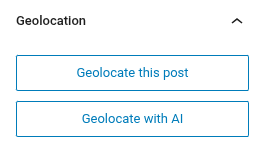
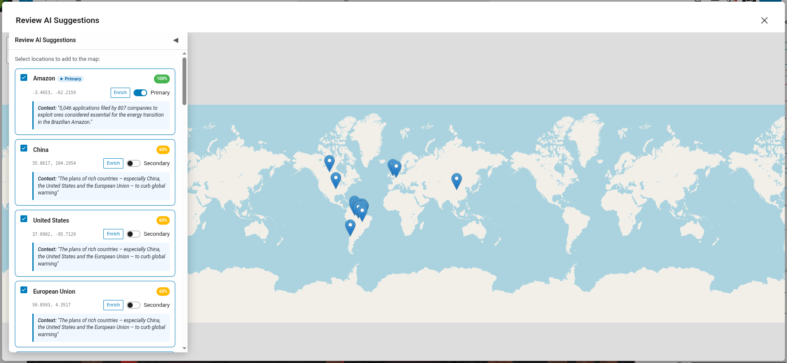
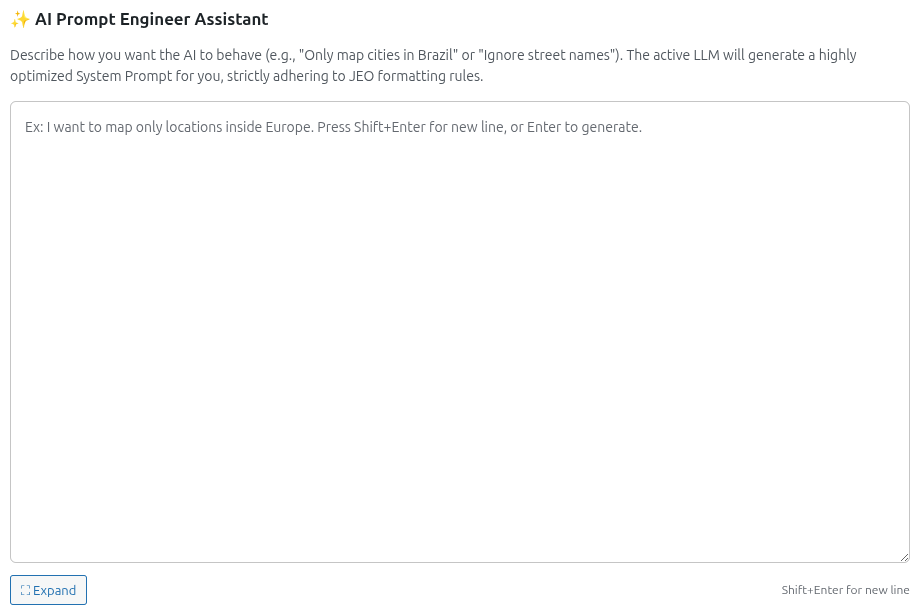
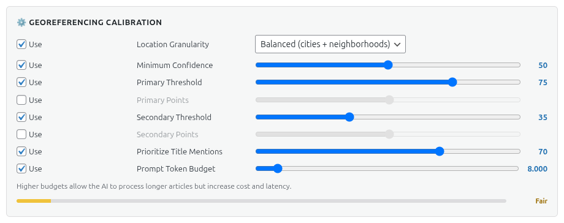

# Georreferenciación con IA

JEO puede georreferenciar tus entradas automáticamente con IA. En lugar de buscar y añadir puntos de geolocalización manualmente, la IA analiza el contenido de tu entrada y sugiere ubicaciones relevantes con coordenadas y puntuaciones de confianza.

Consulta [IA en JEO](ai-in-jeo.md) para una descripción general de cómo funciona el sistema de IA.

## Cómo funciona

Al editar una entrada, el panel de la barra lateral **Geolocalización** incluye un botón **Geolocalizar con IA**. Al hacer clic, se envían el título y el contenido de tu entrada al proveedor de IA configurado, que devuelve puntos de geolocalización sugeridos.

### Flujo

1. Haz clic en **Geolocalizar con IA** en el panel de la barra lateral Geolocalización.
2. La IA analiza el contenido de la entrada e identifica referencias geográficas.
3. Los puntos sugeridos aparecen con el nombre de la ubicación, las coordenadas y una puntuación de confianza.
4. Revisa y aprueba o ajusta los puntos sugeridos.
5. Los puntos se guardan como datos de geolocalización de la entrada.

## Georreferenciación con prompts personalizados

En **Jeo → IA → Proveedor** encontrarás la sección **Asistente de Ingeniería de Prompt de IA**. Describe cómo quieres que se comporte la IA (ej.: "Mapear solo ciudades de Brasil" o "Ignorar nombres de calles") y el LLM activo generará un prompt del sistema optimizado que incorpora tus configuraciones de calibración. El prompt generado puede revisarse y editarse antes de usarlo.

### Calibración

En **Jeo → IA → Proveedor**, en la sección **Calibración de georreferenciación**, puedes ajustar con precisión el comportamiento de la georreferenciación:

- **Granularidad de ubicación**: Controla el nivel de detalle geográfico — Amplia (países, regiones), Equilibrada (ciudades + barrios) o Fina (calles, puntos de referencia, POIs).
- **Confianza mínima**: Puntuación de confianza mínima para que un punto sea sugerido (0–100).
- **Umbral principal**: Puntuación de confianza por encima de la cual una ubicación se clasifica como PRINCIPAL (foco geográfico principal).
- **Puntos principales**: Número máximo de ubicaciones PRINCIPALES que la IA puede sugerir.
- **Umbral secundario**: Rango de puntuaciones de confianza para las ubicaciones SECUNDARIAS (mencionadas pero no centrales).
- **Puntos secundarios**: Número máximo de ubicaciones SECUNDARIAS que la IA puede sugerir.
- **Priorizar menciones en el título**: Cuánto influye el título de la entrada en la detección de ubicaciones de la IA (0–100 %).
- **Presupuesto de Tokens del Prompt**: Presupuesto de tokens para el prompt del sistema generado.

Cada configuración tiene un interruptor **Usar** — desactívalo para excluir esa regla del prompt de la IA.

## Refinamiento en múltiples turnos

Tras la georreferenciación inicial, puedes chatear con la IA para refinar los resultados. Por ejemplo, puedes pedirle que añada una ciudad específica, que elimine un punto incorrecto o que ajuste la confianza de una sugerencia.

El historial de conversación se conserva por entrada, para que puedas seguir refinando en sesiones de edición posteriores.

## Requisitos

- Debe haber un proveedor de IA configurado en **Jeo → IA** (consulta [Configuraciones de IA](ai-settings.md)).
- La entrada debe tener un título y/o contenido para que la IA pueda analizarla.
