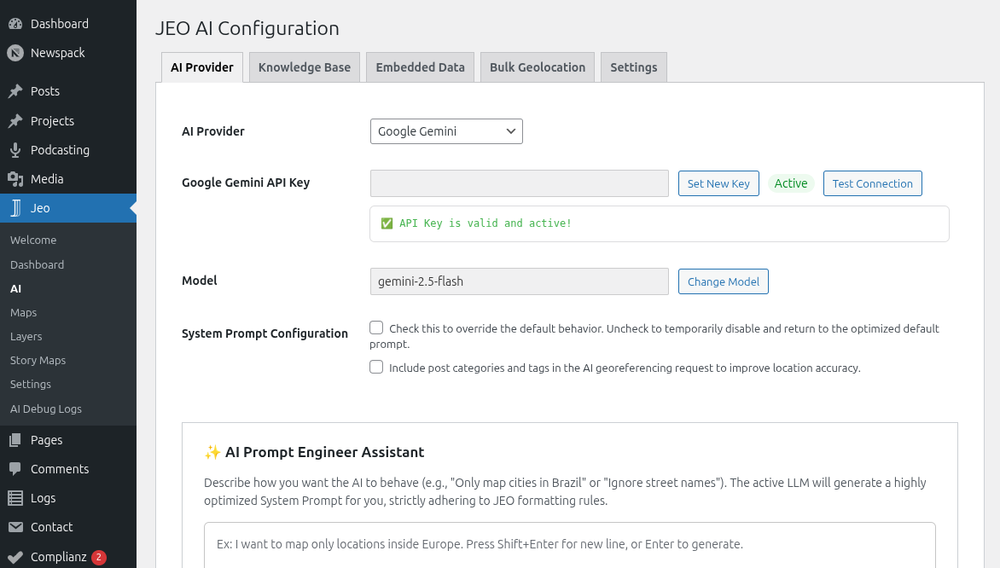
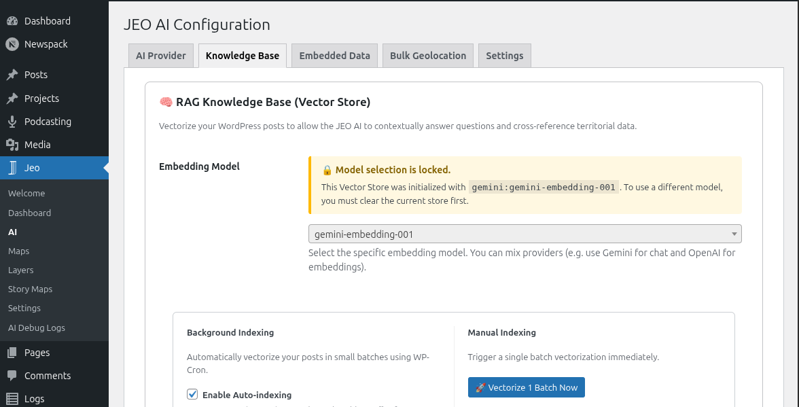

# Configuraciones de IA

JEO incluye funcionalidades de IA integradas para georreferenciar entradas, generar mapas y crear capas de mapa personalizadas. Antes de usar estas funcionalidades, debes configurar un proveedor de IA.

Consulta [IA en JEO](ai-in-jeo.md) para ver una descripción general de la arquitectura de IA y de cómo funciona cada pieza.

## Configurar un proveedor de IA

Ve a **Jeo → IA** en el panel de WordPress. La página de configuración está organizada en pestañas:

### Pestaña Proveedor

Selecciona uno de los 10 proveedores de IA compatibles e introduce tu clave de API:

| Proveedor | Requiere clave de API |
|----------|-----------------|
| Google Gemini | Sí |
| OpenAI | Sí |
| DeepSeek | Sí |
| Anthropic | Sí |
| Ollama | No (local) |
| Mistral | Sí |
| ZAI | Sí |
| HuggingFace | Sí |
| Grok | Sí |
| Cohere | Sí |

Después de seleccionar un proveedor e introducir la clave, haz clic en **Probar conexión** para verificar que funciona.

### Pestaña Base de conocimiento

La Base de conocimiento (RAG) almacena versiones vectorizadas de tus entradas y capas, lo que permite a la IA buscar contenido contextualmente relevante al georreferenciar o generar mapas.

- **Modelo de Embedding**: Elige un modelo de Embedding de tu proveedor (o usa Ollama localmente).
- **Indexación automática**: Indexa automáticamente en segundo plano las entradas y capas nuevas o actualizadas.
- **Tamaño del lote**: Número de elementos procesados por ciclo de indexación.
- **Intervalo del Cron**: Frecuencia con la que se ejecuta la indexación en segundo plano.
- **Resultados de búsqueda (topK)**: Número máximo de coincidencias semánticas devueltas por búsqueda (1–50, valor predeterminado 10).
- **Acciones**: Dispara manualmente la indexación de entradas o capas, crea una copia de seguridad del Almacén de Vectores, restáurala o límpialo.

### Pestaña Datos incorporados

JEO incluye diccionarios geográficos brasileños integrados (biomas, unidades de conservación, tierras indígenas, cuencas hidrográficas y más). Estos ayudan a la IA a reconocer referencias geográficas en tu contenido. Esta pestaña muestra qué diccionarios están cargados.

### Pestaña Geolocalización masiva

Configura las opciones de geolocalización por lotes para procesar muchas entradas a la vez. Consulta [Geolocalización masiva con IA](ai-bulk-geolocation.md) para más detalles.

### Pestaña Asistente de contexto

Personaliza el prompt del sistema que usa el [Asistente de contexto de IA](ai-context-assistant.md), la barra lateral de sugerencias editoriales en el editor de Gutenberg.

- **Usar prompt personalizado**: Marca esta casilla para reemplazar el prompt predeterminado integrado con el tuyo.
- **Prompt personalizado**: Área de texto editable para tu prompt del sistema personalizado. Cuando está desmarcada, la pestaña muestra el prompt predeterminado en un campo de solo lectura, como referencia.

Deja el prompt personalizado vacío para usar el predeterminado integrado, que está optimizado para asistencia editorial periodística con integración RAG.

## Salida estructurada

Cuando está activada (predeterminado), la IA devuelve resultados en un formato JSON estricto impuesto por el proveedor. Esto mejora la precisión de la georreferenciación y de la generación de mapas. Puedes desactivarla en las configuraciones de IA si tu proveedor no la soporta.

## Seguimiento de costos

JEO registra el uso de IA en **Jeo → Registros de Debug de IA**. Cada registro guarda el proveedor, el modelo, los tokens de entrada/salida, y el prompt y la respuesta. Úsalo para monitorear costos y solucionar problemas con las respuestas.
