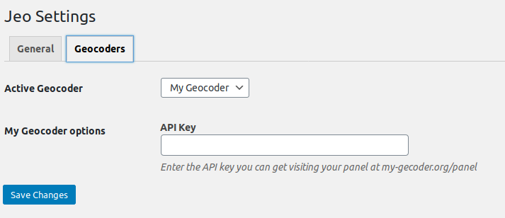

# Cómo escribir un geocodificador

Un geocodificador es un servicio que encuentra coordenadas geográficas a partir de una búsqueda por información de dirección. También es capaz de obtener detalles de la dirección a partir de las coordenadas geográficas, lo que se conoce como geocodificación inversa.

JEO necesita un servicio de geocodificación en algunas situaciones, como cuando los usuarios indican a qué punto de un mapa está relacionada una historia (entradas).

JEO incluye Nominatim como su geocodificador nativo. Se pueden añadir geocodificadores adicionales mediante plugins a través del hook `jeo_register_geocoders`. Esta página documenta cómo hacerlo.

## Registrando un geocodificador

Engancha una función a la acción `jeo_register_geocoders` y realiza el registro con el siguiente código:

```php
add_action('jeo_register_geocoders', function($geocoders) {

    $geocoders->register_geocoder([
        'slug' => 'my-geocoder',
        'name' => 'My Geocoder',
        'description' => __('My Geocoder description', 'my-textdomain'),
        'class_name' => 'MyGeocoderClass'
    ]);

});
```

Esto le dirá a JEO que hay un nuevo servicio de geocodificación disponible y le dará algo de información sobre él.

- El nombre y la descripción se usarán en el panel de administración para que el administrador pueda reconocer los geocodificadores disponibles y elegir cuál se usará.
- slug debe ser un identificador único para el geocodificador
- class_name es el nombre de la clase del geocodificador

## Creando la clase del geocodificador

Ahora necesitamos crear la clase del geocodificador. Será una clase que extiende `\Jeo\Geocoder` e implementa algunos métodos que hacen la geocodificación propiamente dicha.

Dentro del mismo hook, declara la clase y los dos métodos requeridos:

- `geocode($search_string)` El método que recibe la cadena de búsqueda, hace la petición a los servidores del geocodificador y devuelve las coordenadas y los detalles de la dirección;
- `reverse_geocode($lat, $lon)` El método que recibe la latitud y la longitud, hace la petición al servidor del geocodificador y devuelve los detalles completos de la ubicación en el mismo formato que el método `geocode`.

Mientras que `geocode()` devuelve un array de resultados de búsqueda, `reverse_geocode()` devuelve un solo resultado.

Cada resultado es un array que debe tener solo las claves esperadas por el plugin JEO, así que cada geocodificador debe encontrar la mejor correspondencia entre cada campo y los campos esperados por JEO.

Nota: solo `lat` y `lon` son obligatorios.

Respuesta de ejemplo con todos los campos aceptados:

```php
[
        [
            'lat' => '',
            'lon' => '',
            'full_address' => '',
            'country' => '',
            'country_code' => '',
            'region_level_1' => '',
            'region_level_2' => '', // State goes here
            'region_level_3' => '',
            'city' => '',
            'city_level_1' => '',
        ]
]
```

Aquí hay un ejemplo sencillo:

```php
add_action('jeo_register_geocoders', function($geocoders) {

    $geocoders->register_geocoder([
        'slug' => 'my-geocoder',
        'name' => 'My Geocoder',
        'description' => __('My Geocoder description', 'my-textdomain'),
        'class_name' => 'MyGeocoderClass'
    ]);

    class MyGeocoderClass extends \Jeo\Geocoder {

        public function geocode($search_string) {

            $params = [
                'q' => $search_string,
                'format' => 'json',
                'addressdetails' => 1
            ];

            $r = wp_remote_get( add_query_arg($params, 'https://my-geocoder-server.org/search') );

            $data = wp_remote_retrieve_body( $r );

            $data = \json_decode($data);
            $response = [];

            if (\is_array($data)) {

                foreach ($data as $match) {
                    $r = $this->format_response_item( (array) $match );
                    if ($r) $response[] = $r;
                }

            }

            return $response;

        }

        public function reverse_geocode($lat, $lon) {

            $params = [
                'lat' => $lat,
                'lon' => $lon,
                'format' => 'json',
                'addressdetails' => 1
            ];

            $r = wp_remote_get( add_query_arg($params, 'https://my-geocoder-server.org/reverse') );

            $data = wp_remote_retrieve_body( $r );

            $data = \json_decode($data);

            return $this->format_response_item( (array) $data );

        }

        private function format_response_item($match) {

            $response = [
                'lat' => $match['lat'],
                'lon' => $match['lon'],
                'full_address' => $match['display_name'],
                'country' => $match['country'],
                'country_code' => $match['country_code'],
                'region_level_1' => $match['region_level_1'],
                'region_level_2' => $match['region_level_2'], // State goes here
                'region_level_3' => $match['region_level_3'],
                'city' => $match['city'],
                'city_level_1' => $match['city_level_1'],
            ];

            return $response;

        }

    }

});
```

¡Y eso es todo! ¡Tu nuevo geocodificador está listo!

## Añadiendo configuraciones adicionales al geocodificador

Algunos servicios de geocodificación podrían necesitar u ofrecer configuraciones adicionales. Algunos podrían requerir que el usuario ingrese su clave de API; otros podrían permitir a los usuarios restringir la búsqueda a un país específico para obtener mejores resultados al buscar.

También puedes añadir fácilmente nuevas configuraciones a tu geocodificador que se presentarán automáticamente al usuario en la página de Configuraciones.

Declara un método `get_settings()` en tu clase que devuelva un array con todas las configuraciones que tu geocodificador acepta.

Cada configuración se describe con un array con las siguientes claves:

- `slug`: un slug para tu opción. No tienes que preocuparte por los conflictos de nombres; se almacenará dentro de las opciones de tus geocodificadores;
- `name`: un nombre legible;
- `description`: una explicación para el usuario sobre qué es esta configuración.

Veamos un ejemplo solo con el código relevante:

```php
add_action('jeo_register_geocoders', function($geocoders) {

    // ...
    class MyGeocoderClass extends \Jeo\Geocoder {

        // ...

        public function get_settings() {

            // Note it is an array of arrays
            return [
                [
                    'slug' => 'api_key',
                    'name' => __('API Key', 'my-text-domain'),
                    'description' => __('Enter the API key you can get visiting your panel at my-gecoder.org/panel', 'my-text-domain')
                ]
            ];

        }

    }

});
```

Y esto es lo que verás en el panel de administración:



## Accediendo a los valores de las configuraciones

Ahora que has registrado una configuración y el usuario puede cambiar su valor en el panel de administración, puedes usarla en tu geocodificador.

Para obtener su valor, simplemente llama a `$this->get_option($option_name)`.

Ejemplo:

```php
// ...

        // ...

        public function geocode($search_string) {

            $params = [
                'q' => $search_string,
                'format' => 'json',
                'addressdetails' => 1,
                'api_key' => $this->get_option('api_key')
            ];

            // ...

            return $response;

        }

// ...
```

## Declarando valores predeterminados

También puedes añadir el método `get_default_options()` a tu clase para establecer valores predeterminados para cada configuración. Esto es opcional y se hace así:

```php
add_action('jeo_register_geocoders', function($geocoders) {

    // ...
    class MyGeocoderClass extends \Jeo\Geocoder {

        // ...

        public function get_default_options() {

            return [
                'api_key' => 'sand-box-api-key' // the key must match the slug of the setting registered in get_settings()
            ];

        }

    }

});
```

## Avanzado: personalización aún mayor de las configuraciones

Si tu geocodificador necesita configuraciones especiales que un simple campo de texto no puede manejar, hay otro método que puedes declarar para añadir código HTML arbitrario a la página de Configuraciones.

`settings_footer($settings)` debe hacer echo de código HTML que se renderizará al final de la página de configuraciones de tu geocodificador.

Recibe el objeto `$settings`, que es una instancia de `\Jeo\Settings` y tiene algunos helpers que puedes usar.

Solo necesitas imprimir los campos del formulario con los nombres correctos y JEO se encargará de guardarlos por ti.

Para obtener el nombre correcto del campo usa `$settings->get_geocoder_option_field_name($name)`.

Ejemplo:

```php
// ...

        // ...

        public function settings_footer($settings) {

            ?>
            <p><strong>My Select option</strong></p>

            <select name="<?php echo $settings->get_geocoder_option_field_name('new_option'); ?>">
                <option value="yes" <?php selected( $this->get_option('new_option'), 'yes' ); ?> >
                    Yes
                </select>
                <option value="no" <?php selected( $this->get_option('new_option'), 'no' ); ?> >
                    No
                </select>
            </select>
            <?php

        }

// ...
```

Nota: `selected()` es una función nativa de WordPress. Consulta la [documentación oficial](https://developer.wordpress.org/reference/functions/selected/)
