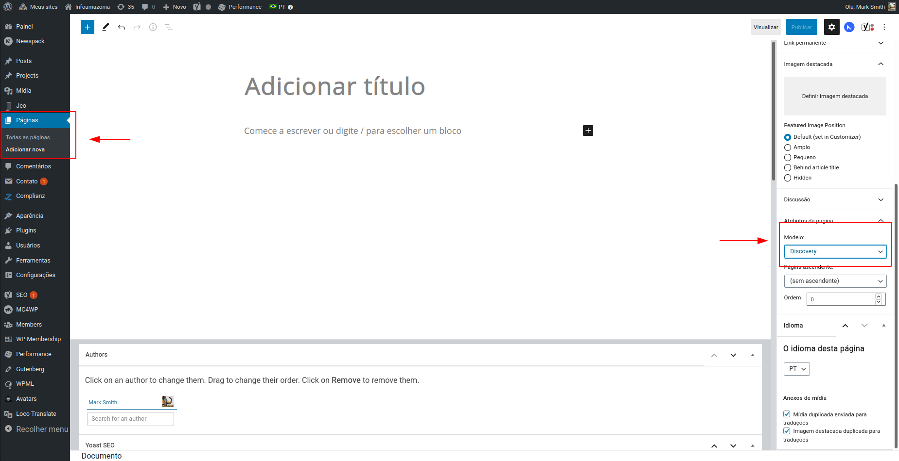
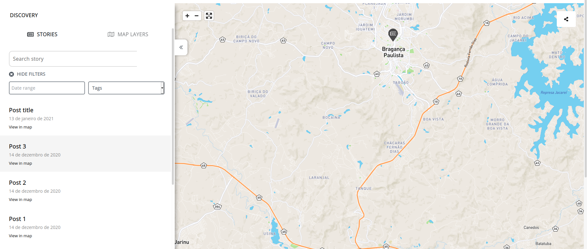
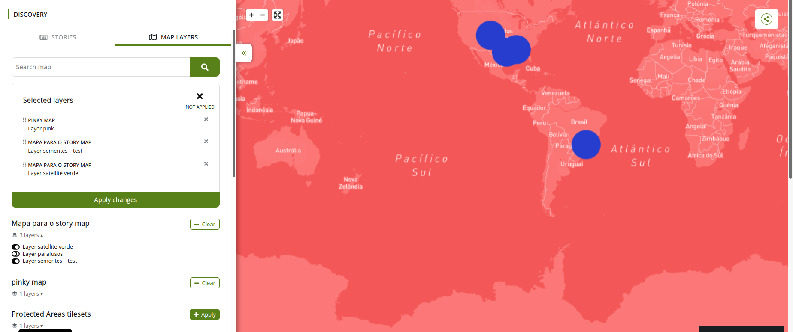
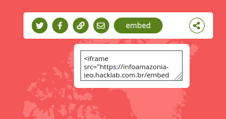

# Discovery

La página de Discovery es un mapa interactivo donde el usuario puede añadir capas, ver historias basadas en entradas geolocalizadas publicadas y compartir su propio mapa personalizado con otras personas.
La página de Discovery tiene una barra lateral a la izquierda con dos pestañas: **HISTORIAS** y **CAPAS DEL MAPA**. Puedes ocultar esta barra lateral haciendo clic en el ícono de las dos flechas hacia la izquierda, a la derecha de la barra lateral.

## Cómo crear una página de Discovery

Para crear una página de Discovery, solo tienes que crear una página normal de WordPress y seleccionar `Discovery` en las configuraciones de Modelo.

Cualquier contenido que se añada a esa página será ignorado, y la página solo mostrará la funcionalidad de Discovery.

## Historias

Las historias son las entradas geolocalizadas que se muestran en el mapa. Al hacer clic en `MOSTRAR FILTROS` puedes filtrar estas historias por fecha y etiquetas. Debajo de estos filtros se mostrará una lista con los resultados. Cada resultado también es un enlace a la propia historia. Además, al pasar el mouse sobre un marcador del mapa se resalta la historia relacionada en la barra lateral izquierda. De la misma manera, al pasar el mouse sobre el texto `Ver en el mapa` se resalta el marcador del mapa correspondiente.

## Capas del mapa

En la pestaña Capas del mapa puedes buscar mapas y aplicar sus capas a tu mapa interactivo. Puedes filtrar mapas por nombre y seleccionar diferentes capas de diferentes mapas. Después de seleccionar al menos una capa de un mapa, puedes hacer clic en `Limpiar` para eliminar todas las capas seleccionadas de ese mapa antes de aplicar los cambios. También es posible añadir todas las capas de un mapa con un solo clic, seleccionando **Aplicar** junto a un resultado de mapa.

En la parte superior de la barra lateral podrás ver todas las capas seleccionadas, con la posibilidad de eliminar algunas. Estas capas siempre tienen una función de arrastrar y soltar para que puedas reordenarlas. Después de revisar estas capas, debes hacer clic en `Aplicar cambios` para mostrarlas en el mapa de Discovery.

## Compartir

En la esquina superior derecha del mapa hay un botón para compartir con el que puedes compartir el contenido en **Twitter**, en **Facebook**, por **E-mail** o incluso generar un enlace personalizado para tu mapa. Además, al hacer clic en `Embed` aparece una ventana emergente con un código HTML para incrustar tu mapa personalizado en otro sitio web.

