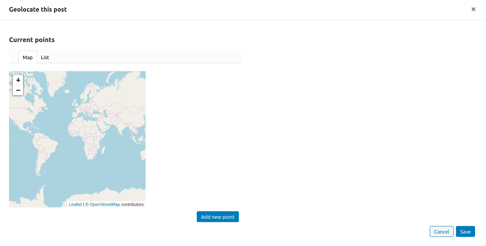
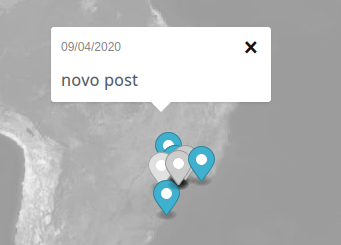

# Geolocalización de entradas

Al editar una entrada, JEO añadirá un panel adicional a la barra lateral: **Geolocalización**. Al hacer clic en **Geolocalizar este post**, se mostrará una ventana emergente.

Se pueden añadir nuevos puntos a la entrada haciendo clic en el botón **Añadir nuevo punto**. Puedes buscar una ubicación específica en la barra de búsqueda.

También es posible elegir la relevancia de cada punto, lo cual es útil cuando tienes más de un punto.

## Visualizar un mapa con entradas geolocalizadas

Los mapas con entradas geolocalizadas contienen marcadores en la ubicación de cada entrada. Al hacer clic en ellos se abrirá una ventana emergente con su título y fecha de publicación. Al hacer clic en el título, irás a la entrada propiamente dicha.

## Georreferenciación con IA

Alternativamente, JEO puede georreferenciar entradas automáticamente usando IA. La IA analiza el contenido de la entrada y sugiere puntos de geolocalización con puntuaciones de confianza. Después puedes revisar y aprobar las sugerencias. Consulta [Georreferenciación con IA](ai-georeferencing.md).

Para procesar muchas entradas en lote, consulta [Geolocalización masiva con IA](ai-bulk-geolocation.md).
