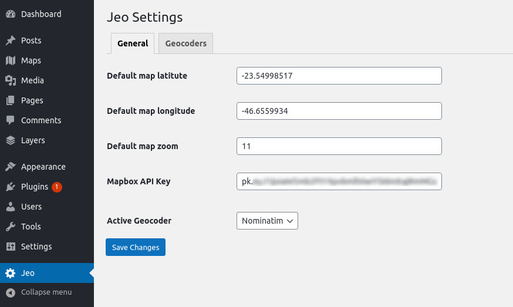
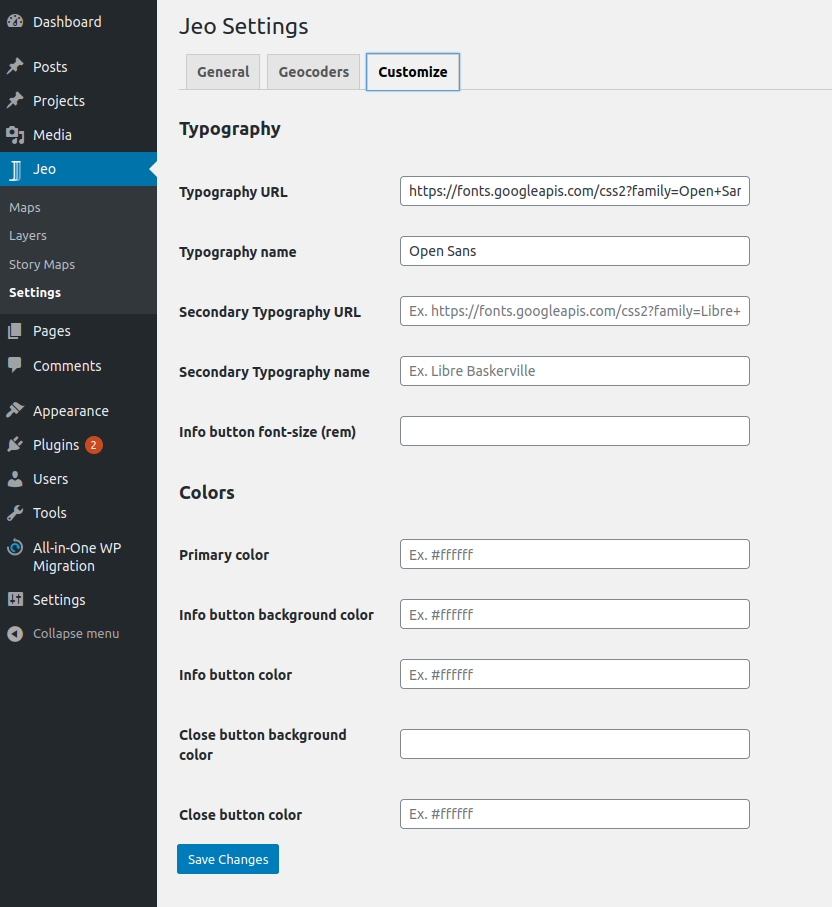
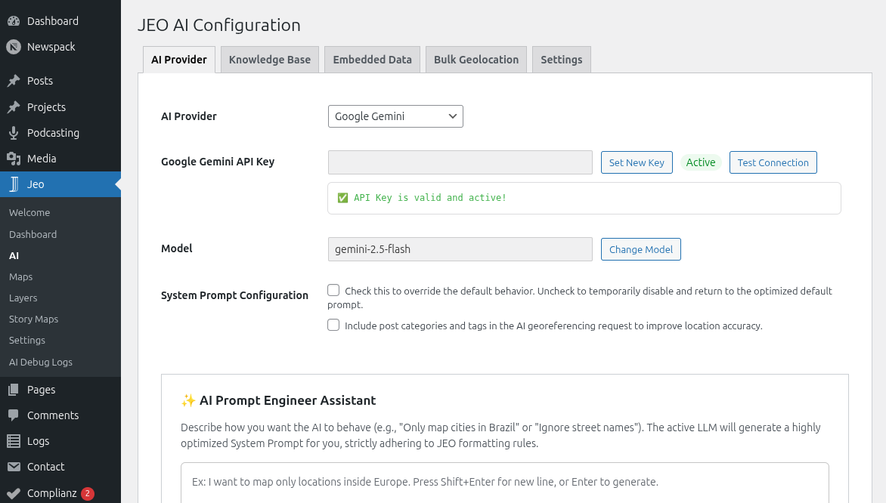

# Primeros pasos

## Instalación

Tras activar el plugin, aparecerá un nuevo elemento en el panel de WordPress: el menú **JEO**, que contiene:

- **Mapas** — Crea y gestiona entradas de mapas interactivos
- **Capas** — Crea y gestiona entradas de capas de datos
- **Mapas Narrativos** — Crea experiencias de mapa con scrollytelling
- **IA** — Configura proveedores de IA, la base de conocimiento y la geolocalización masiva
- **Configuraciones** — Configuraciones generales de mapa, geocodificador y estilo

## Configurar el plugin

En el menú principal de JEO, en **JEO → Configuraciones**, puedes configurar:

* la latitud, la longitud y el zoom predeterminados de tus mapas;
* las [configuraciones de la API de Mapbox](https://docs.mapbox.com/help/how-mapbox-works/access-tokens/) que usará el plugin;
* el geocodificador que usará el plugin — actualmente [Nominatim](https://nominatim.openstreetmap.org/) es la opción integrada, con extensibilidad para otros geocodificadores vía hook.
* el estilo de algunas funcionalidades del plugin, como fuentes y colores.

## Configurar las funcionalidades de IA

En **JEO → IA**, puedes configurar las funcionalidades con IA:

* Selecciona un proveedor de IA (Google Gemini, OpenAI, DeepSeek, Anthropic, Ollama, Mistral, entre otros) e introduce la clave de API.
* Configura la Base de conocimiento (RAG) para indexar tus entradas y capas y obtener resultados de IA más inteligentes.
* Configura la geolocalización masiva para procesar entradas en lotes.

Consulta [Configuraciones de IA](ai-settings.md) para instrucciones detalladas.

