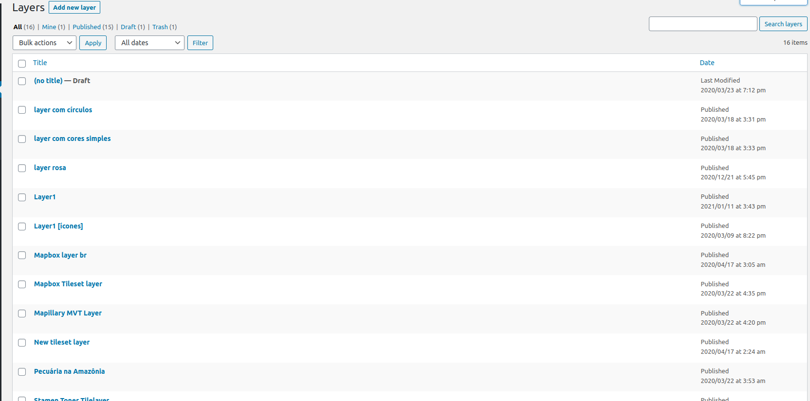
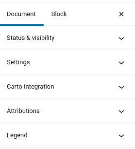
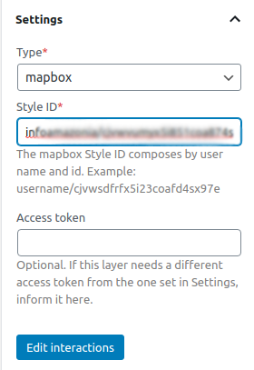
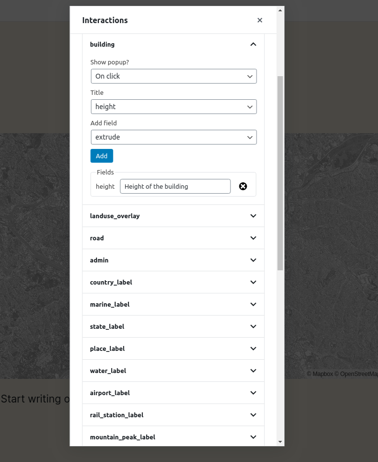
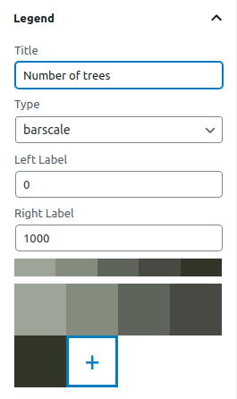

# Crear una capa

Uno de los tipos de contenido personalizados que proporciona el plugin JEO es **Capa**. Las capas son donde añades leyendas, colores y fuentes de datos a tus mapas. Un mapa puede contener una o más capas.

Al entrar en el editor de la capa, verás una vista previa de la capa actual (o de una capa predeterminada, si la capa actual aún no se ha editado) y tres paneles en la barra lateral: **Configuraciones**, **Atribuciones** y **Leyenda**.

## Configuraciones de la capa

En el panel **Configuraciones de la capa**, puedes cambiar el tipo de capa.

JEO admite siete tipos de capa listos para usar:

| Tipo | Campos obligatorios | Campos opcionales | Ideal para |
|------|-----------------|-----------------|----------|
| [Estilos de Mapbox](https://docs.mapbox.com/studio-manual/overview/map-styling/) | ID del estilo (`username/style-id`) | Token de acceso | Mapas completos con estilos creados en Mapbox Studio |
| [JSON de estilo](https://maplibre.org/maplibre-style-spec/) | URL del estilo o JSON de estilo incrustado | — | Estilos públicos de MapLibre GL; funciona sin clave de API |
| [Tilesets de Mapbox](https://docs.mapbox.com/help/glossary/tileset/) (ráster) | ID del tileset (`username.tilesetid`) | Token de acceso | Datos ráster alojados en Mapbox |
| [Tilesets vectoriales de Mapbox](https://docs.mapbox.com/vector-tiles/reference/) | ID del tileset, capa de origen | Token de acceso | Datos vectoriales alojados en Mapbox |
| [Teselas vectoriales de Mapbox](https://docs.mapbox.com/vector-tiles/reference/) (MVTs) | URL del tileset, capa de origen, tipo de geometría | Token de acceso | Datos vectoriales con elementos interactivos |
| [GeoJSON](https://geojson.org/) | URL del GeoJSON o GeoJSON incrustado | Estilo de la capa | Datos de polígonos renderizados en el cliente, incluidas las capas de límites generadas por IA |
| [TileLayers](https://en.wikipedia.org/wiki/Tiled_web_map) | Plantilla de URL de tile (`https://.../{z}/{x}/{y}.png`) | — | Servidores de tiles de terceros (URLs XYZ) |

Si el campo **Token de acceso** se deja vacío, la capa usará la clave de API de Mapbox configurada en **JEO → Configuraciones**. Solo necesitas completar este campo cuando la capa requiera un token diferente del global.

También hay un botón **Editar interacciones**. Ahí puedes añadir popups a tu capa cuando se realizan acciones específicas (hacer clic o pasar el mouse) (p. ej.: hacer clic en un edificio y mostrar su altura).

## Leyenda de la capa

En el panel **Leyenda de la capa**, puedes añadir leyendas a tu capa (barscale, simple-color, icons o circles) y personalizar sus colores.

## Atribuciones

Aquí es donde puedes asignar los créditos de la capa, definiendo un enlace para descargarla o acceder a más información sobre ella. Estas atribuciones se mostrarán en la parte inferior del mapa y dentro de la ventana emergente que aparece al hacer clic en el botón `Información` de un mapa.
