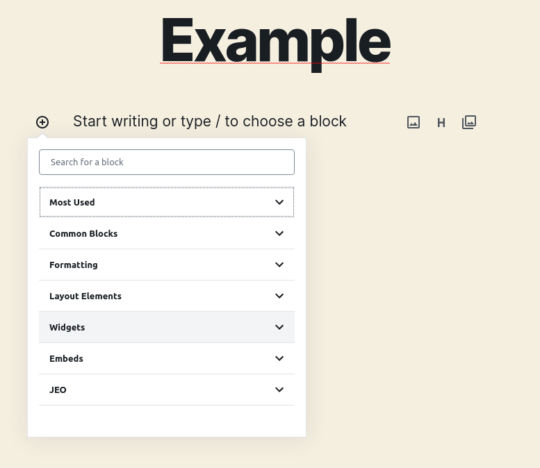
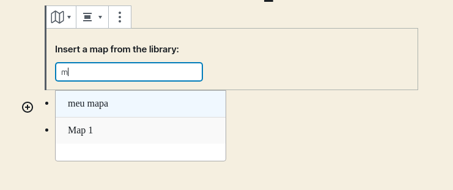
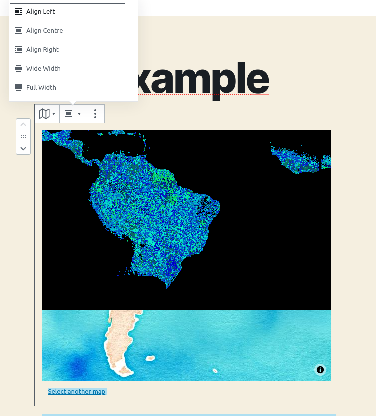
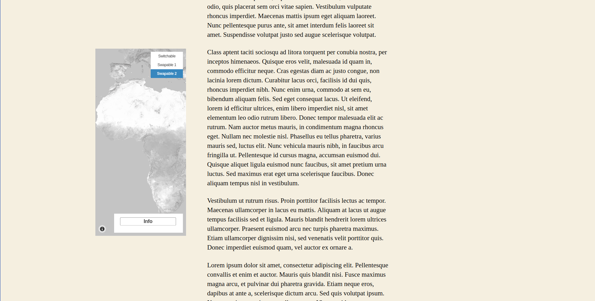
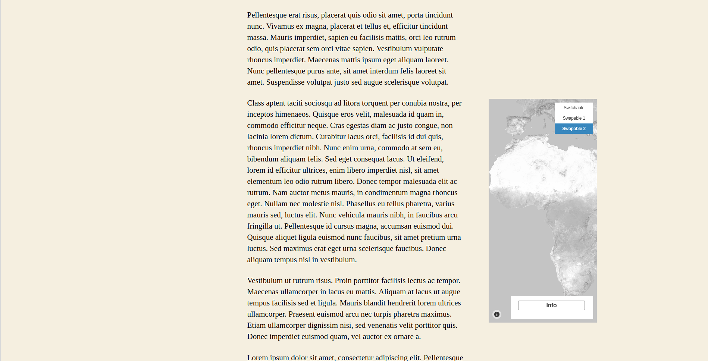
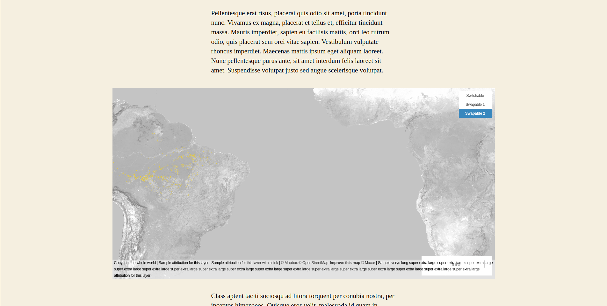
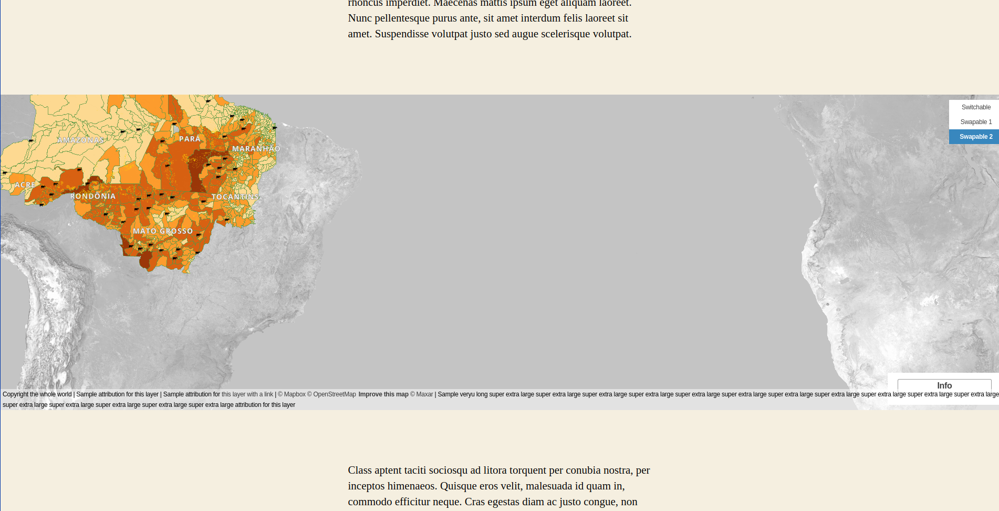
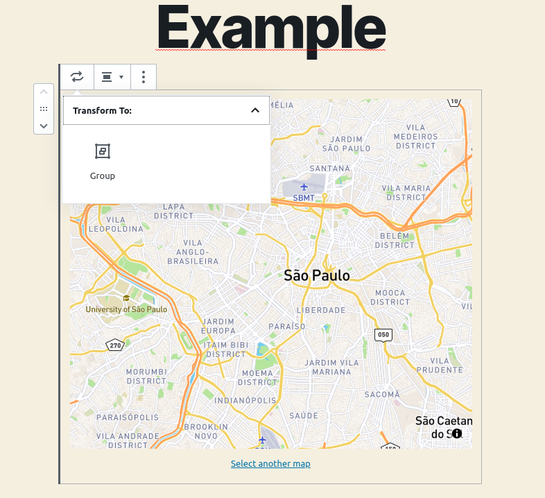
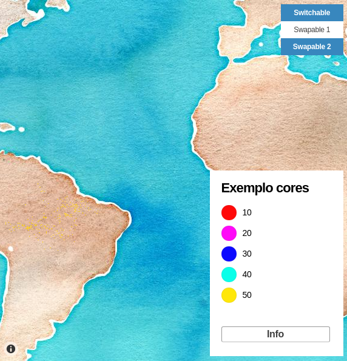
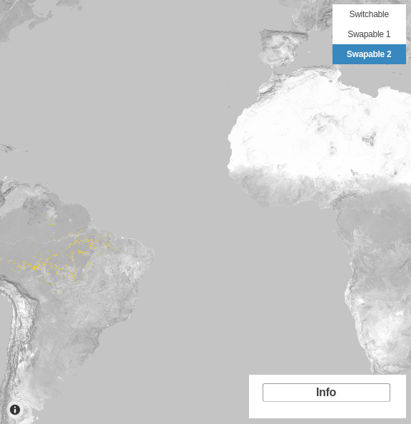

# Bloque de mapa

Después de [crear mapas](map-post.md), puedes mostrarlos dentro de cualquier entrada usando el bloque **Mapa JEO**.

## Añadir un mapa a una entrada

Al crear una nueva entrada, encontrarás una nueva categoría de bloques: **JEO**.

Selecciona el bloque **Mapa JEO** y busca cualquier mapa que hayas creado.

### Opciones de alineación

Con un mapa seleccionado, puedes elegir una alineación:

| Alineación | Descripción |
|-----------|-------------|
| Centro | Predeterminado. El mapa se centra dentro del área de contenido |
| Izquierda | El mapa flota a la izquierda con el texto alrededor |
| Derecha | El mapa flota a la derecha con el texto alrededor |
| Ancho amplio | El mapa se extiende más allá del área de contenido |
| Ancho completo | El mapa abarca todo el ancho de la página |

## Agrupar mapas

Además de la opción de alineación, también hay disponible una funcionalidad de agrupación para organizar varios mapas juntos.

## Intercambio de capas

Si tu mapa tiene más de una capa, puedes intercambiarlas y seleccionar cuál quieres ver, según la configuración de las capas del mapa. [Consulta más sobre las capas del mapa aquí](layer-post.md)

