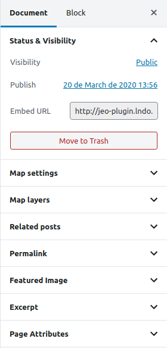
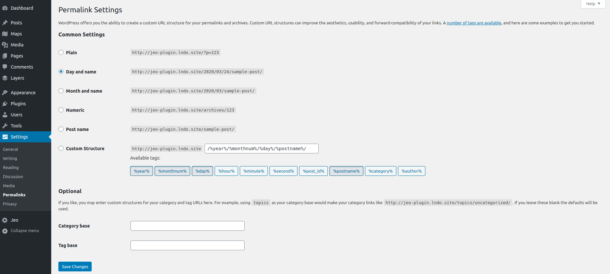

# Incrustar un mapa

El plugin JEO permite insertar un mapa en una entrada pegando un enlace en el editor. Esto es lo que se llama `Embed map` y es muy fácil de hacer.

Al editar un [Mapa](map-post.md), uno de los paneles de configuración es `Status & Visibility`. Allí puedes encontrar la `embed URL` de ese mapa en particular.

Copiar este enlace y pegarlo en el editor de entradas dará como resultado un mapa incrustado.

**Advertencia**: Si tu entrada muestra un error *Not Found*, sigue estos pasos:

- Ve al Escritorio de WordPress > Ajustes > Enlaces permanentes
- Cambia los Ajustes comunes (puedes cambiar a una opción diferente y luego volver a la original) y haz clic en `Save Changes`

Ahora deberías poder ver los mapas incrustados sin problemas.
