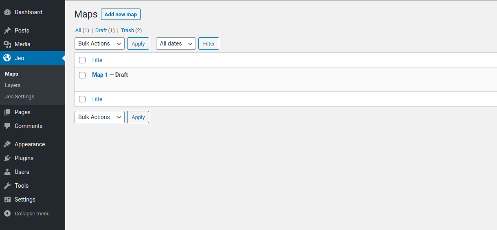
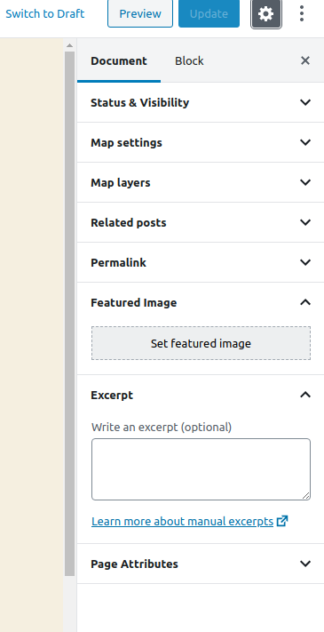
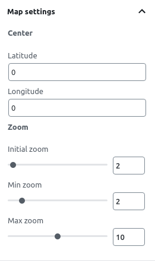
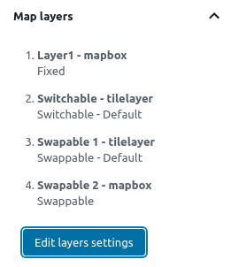
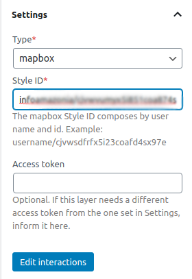
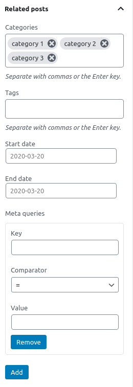

# Crear mapas

Uno de los tipos de contenido personalizados que proporciona el plugin JEO es **Mapa**.

Al entrar en el editor del mapa, verás una vista previa del mapa actual (o de un mapa predeterminado, si no hay capas seleccionadas) y tres paneles en la barra lateral: **Configuración del mapa**, **Capas del mapa** y **Entradas relacionadas**.

## Configuración del mapa

En el panel **Configuración del mapa**, puedes cambiar el centro inicial del mapa definiendo una latitud y una longitud. También puedes cambiar las configuraciones predeterminadas de zoom o incluso desactivarlo.

Al ver un mapa en una entrada, hacer clic con el botón derecho del mouse y arrastrar hace que el mapa gire. Desplazar la rueda del mouse cambia el zoom del mapa. Ambas opciones se pueden activar o desactivar con las casillas de verificación.

## Capas del mapa

En el panel **Capas del mapa**, puedes ver todas las capas que forman parte del mapa.

Al hacer clic en **Editar configuraciones de capas** se abre una ventana emergente. Ahí puedes añadir, quitar y reordenar capas, definir sus tipos y elegir si sus leyendas se mostrarán en el mapa. También puedes cargar interacciones específicas para cada capa haciendo clic en `Cargar interacciones`.

### Tipos de leyenda

La leyenda de cada capa se puede configurar como uno de estos tipos:

- **Fijo**: La capa siempre está visible. Ideal para capas de referencia base.
- **Conmutable**: El usuario puede activar y desactivar la capa de forma independiente. Ideal para superposiciones opcionales.
- **Intercambiable**: Solo una capa intercambiable está visible a la vez (comportamiento de botones de opción). Ideal para comparar diferentes conjuntos de datos.

### Estilo de la capa

Algunos tipos de capa admiten estilos personalizados. Al usar **teselas vectoriales de Mapbox** con geometría `fill`, `line` o `circle`, un editor de estilos te permite personalizar colores, opacidad y filtros. Las capas generadas por IA también incluyen un estilo predeterminado sugerido que puedes aceptar o reemplazar. Otros tipos de capa (estilos de Mapbox, tilesets, TileLayers) usan el estilo definido en su origen.

[Consulta cómo crear nuevas capas aquí](layer-post.md)

## Entradas relacionadas

En el panel **Entradas relacionadas**, puedes definir qué entradas geolocalizadas se usarán como marcadores en el mapa. Puedes filtrar entradas por categorías, etiquetas, intervalo de fechas o — para usos avanzados — consultas de metadatos usando el `post_meta` de WordPress.

