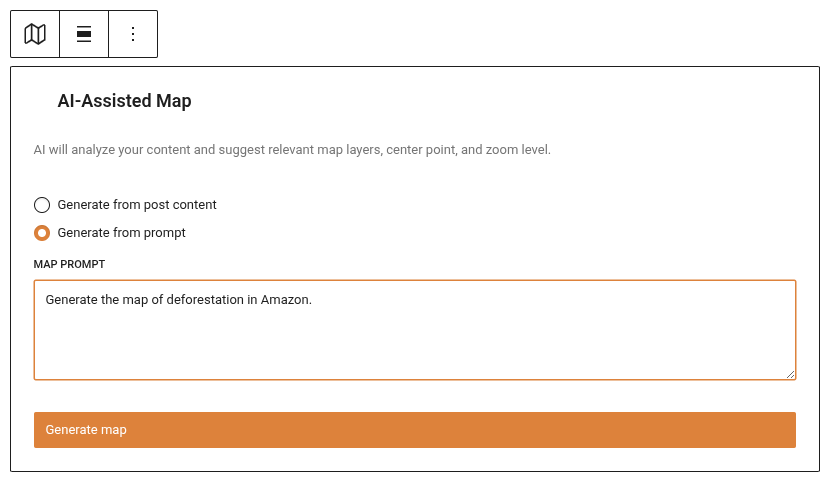
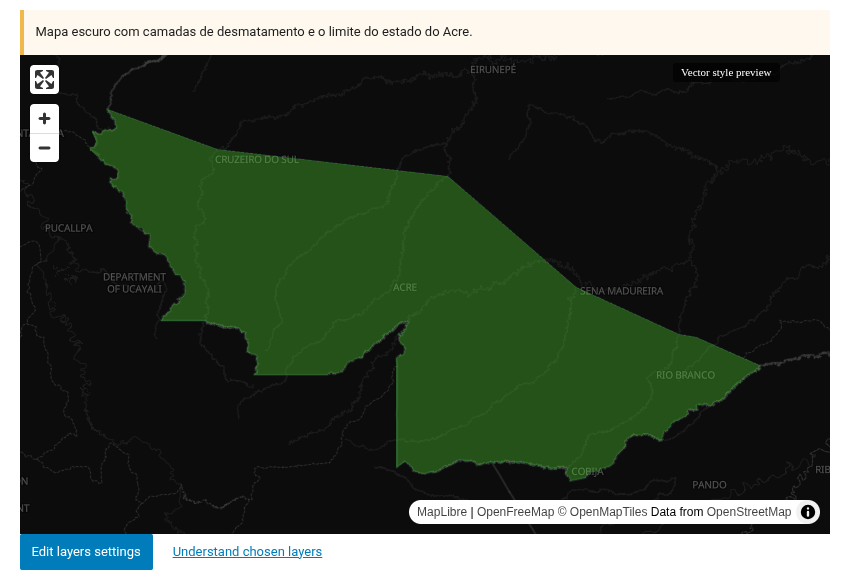
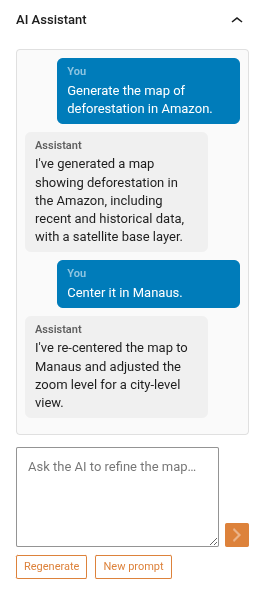
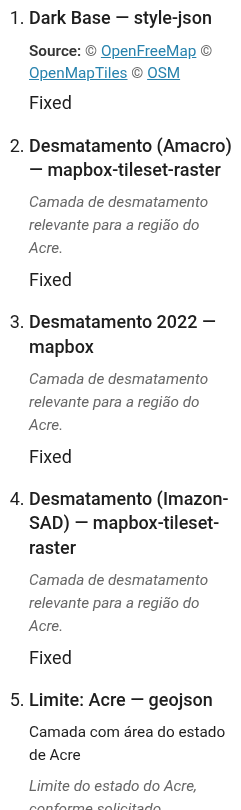

# Minimapa — Bloque de mapa asistido por IA

El bloque Minimapa (`jeo/ai-minimap`) genera mapas interactivos contextuales dentro del editor de Gutenberg usando IA. Describe lo que necesitas en lenguaje natural y la IA construye un mapa con las capas adecuadas, el punto central, el nivel de zoom y los pines de geolocalización.

Consulta [IA en JEO](ai-in-jeo.md) para saber cómo RAG, los agentes y las herramientas hacen funcionar esta característica.

## Insertar el bloque

1. En el editor de Gutenberg, haz clic en el botón **+** para añadir un nuevo bloque.
2. Busca **Minimapa IA de JEO** y selecciónalo.
3. El bloque comienza en estado **inactivo** con dos modos de generación:
   - **A partir del contenido de la entrada**: Genera automáticamente un mapa basado en el contenido de la entrada actual y sus puntos de geolocalización.
   - **A partir del prompt**: Describe el mapa que quieres en un campo de texto.

## Generar un mapa

### A partir del contenido de la entrada

Haz clic en **Generar a partir del contenido de la entrada**. El sistema busca tus capas existentes y los datos de geolocalización de la entrada para construir un mapa contextual. No se necesita ningún prompt de IA — utiliza RAG (Generación Aumentada por Recuperación) para encontrar capas relevantes automáticamente.

### A partir del prompt

Escribe una descripción del mapa que quieres (por ejemplo, "Un mapa de la región amazónica que muestre datos de deforestación y ríos") y haz clic en **Generar**. El agente de IA hará lo siguiente:

1. Analizar tu prompt y el contenido de la entrada actual.
2. Buscar capas existentes relevantes en tu Base de conocimiento.
3. Geocodificar las ubicaciones relevantes.
4. Devolver un mapa completo con capas, centro, zoom y pines.

## Refinamiento por chat

Una vez generado un mapa, el bloque entra en estado **listo**. Se abre un **panel del inspector** en la barra lateral de Gutenberg donde puedes refinar el mapa mediante chat:

- **Mensajes de texto**: Escribe instrucciones como "Acércate a São Paulo" o "Quita la capa de agua".
- **Regenerar**: Empieza de cero con una sugerencia de mapa completamente nueva.
- **Nuevo prompt**: Introduce una nueva descripción para generar un mapa diferente (conserva el contexto de la conversación).
- **Variante de capa base**: Cambia entre capas base oscura, clara y de satélite.

La IA recuerda tu conversación, por lo que cada refinamiento se construye sobre el contexto anterior.

## Entender las capas elegidas

¿Alguna vez te has preguntado por qué la IA eligió una capa específica? Debajo de la vista previa del mapa, haz clic en **Entender capas elegidas** para abrir el panel **Capas del mapa** en la barra lateral del bloque. Para cada capa verás:

- **Título y tipo** — p. ej. "Alertas de deforestación — mapbox".
- **Descripción** — el extracto de la capa, cuando está disponible.
- **Por qué fue elegida** — la explicación de la propia IA para incluir la capa en este mapa.
- **Aviso de estilo automático** — cuando la IA tuvo que aplicar un estilo a una capa que no tenía ningún estilo guardado, para que sepas que puede personalizarse.
- **Temas y fuente** — los temas de la capa y la atribución de los datos, para desambiguar cuando existan capas con nombres similares.

## Capas generadas por IA (Minilayer)

Si tienes configurada una clave de API de Mapbox, la IA puede **generar capas de mapa personalizadas** cuando las capas existentes no cubren lo que necesitas. Durante el chat, pide a la IA que cree una capa (por ejemplo, "¿Puedes generar un mapa de calor de deforestación para la Amazonía?"). La IA pedirá tu confirmación antes de generar — nunca crea capas sin aprobación explícita. La nueva capa se añade al mapa automáticamente con un estilo sugerido por la IA (colores y filtros) que después puedes sobrescribir en el modal de configuración de la capa mediante la casilla **"Usar estilo predeterminado sugerido por IA"**.

## Características del mapa

Después de la generación, el minimapa se comporta como cualquier mapa de JEO:

- **Desplazamiento y zoom**: Arrastra para desplazarte, usa el scroll para hacer zoom.
- **Capas**: Capas temáticas con leyendas.
- **Pines**: Pines de geolocalización provenientes de los datos de geolocalización de la entrada. Usa el panel **Pines de geolocalización** (Mostrar pines: Sí/No) para controlarlos — se renderizan en vivo en la vista previa del editor y en el frontend.
- **Capa base**: Elegida automáticamente (oscura/clara) según los colores de las capas, o seleccionada manualmente.

## Requisitos

- Debe haber un proveedor de IA configurado en **Jeo → AI** (consulta [Ajustes de IA](ai-settings.md)).
- Para obtener los mejores resultados, indexa tus entradas y capas en la Base de conocimiento (pestaña RAG).
- Para las capas temáticas generadas por IA, también se requiere una clave de API de Mapbox. Las capas de límites (municipios, estados, tierras indígenas) se generan como GeoJSON y funcionan sin clave de Mapbox.
