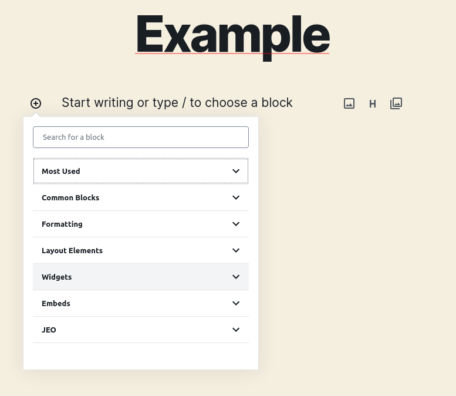
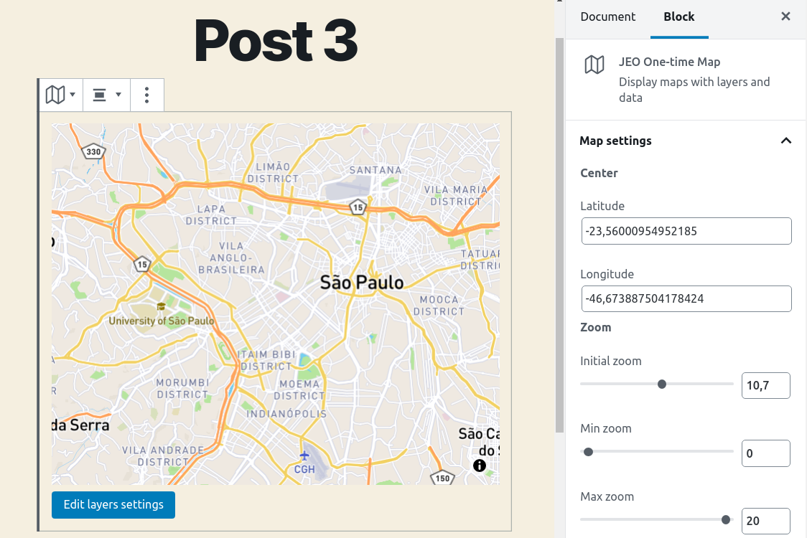

# Bloque de mapa de un solo uso

Es posible usar mapas en las entradas sin tener que crear un mapa nuevo ni usar uno existente. Para esto, el plugin JEO pone a disposición otro tipo de bloque: **Mapa de un solo uso**.

Al crear una nueva entrada, ten en cuenta que hay disponible una nueva categoría de bloques: **JEO**.

Al seleccionar el bloque **JEO Mapa de un solo uso**, aparecerá una vista previa estándar del mapa. Este tipo de mapa permite todas las mismas personalizaciones que un [Mapa JEO](map-post.md) normal, como: modificar coordenadas, ajustes de zoom, entradas relacionadas, opciones de alineación y [configuración de capas](layer-post.md). Para saber con más precisión cómo personalizar todas estas opciones, consulta la página del [Mapa JEO](map-post.md).

