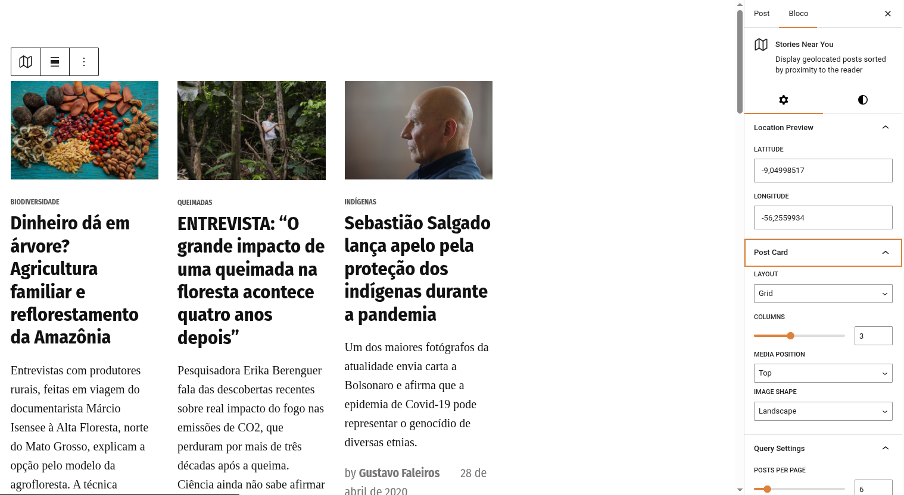
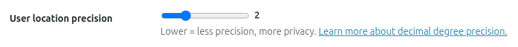
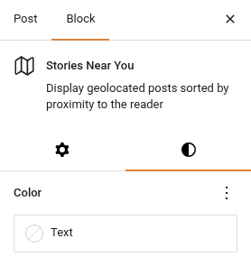

# Historias cerca de ti

El bloque **Historias cerca de ti** (`jeo/stories-near-you`) muestra las entradas geolocalizadas más cercanas a la ubicación actual del lector. Usa la API de geolocalización del navegador (con consentimiento explícito del usuario) para encontrar historias cercanas y las presenta en un diseño de tarjetas personalizable.

## Insertar el bloque

1. En el editor de Gutenberg, haz clic en el botón **+** para añadir un nuevo bloque.
2. Busca **Historias cerca de ti** y selecciónalo.
3. Configura los ajustes del bloque en los paneles del inspector.

## Cómo funciona

Cuando un visitante carga una página con este bloque:

1. El bloque muestra una **solicitud de consentimiento**: "Usar mi ubicación" u "Omitir".
2. Si el usuario acepta, el navegador obtiene sus coordenadas (redondeadas para proteger la privacidad según el ajuste de **precisión de la geolocalización**).
3. Si el usuario lo omite, el bloque recurre al centro predeterminado del mapa configurado en las Configuraciones de JEO.
4. El bloque consulta la base de datos de WordPress en busca de las entradas geolocalizadas más cercanas usando la distancia geográfica (`ST_Distance_Sphere`).
5. Las entradas se muestran como tarjetas en el diseño elegido.

### Precisión de la geolocalización

El ajuste **Precisión de ubicación del usuario** (en JEO → Configuraciones → General) controla cuántos decimales se conservan de la geolocalización del navegador. Rango: 1–5, predeterminado: 2. Los valores más bajos significan menos precisión pero más privacidad.

## Ajustes del bloque

Los paneles del inspector ofrecen una amplia personalización:

### Tarjeta de entrada

- **Layout**: Cuadrícula o Lista.
- **Posición de la imagen**: Arriba, Izquierda, Derecha o Detrás (la imagen se coloca detrás del texto).
- **Forma de imagen**: Horizontal, Vertical, Cuadrada o Sin recortar.
- **Columnas**: Número de columnas en el diseño de cuadrícula (1–6).

### Ajustes de consulta

- **Entradas por página**: Total de entradas a mostrar (máx. 36).
- **Tipo de contenido**: Filtra por tipo de contenido (solo se muestra si existen varios tipos con geolocalización activada).

### Filtros

- **Categorías**: Incluye categorías específicas.
- **Etiquetas**: Incluye etiquetas específicas.
- **Excluir categorías**: Excluye categorías específicas.
- **Excluir etiquetas**: Excluye etiquetas específicas.
- **Taxonomías personalizadas**: Filtra por términos de taxonomías personalizadas.

### Visualización

- **Imagen destacada**: Muestra/oculta la imagen destacada.
- **Categoría**: Muestra/oculta la insignia de categoría.
- **Fecha**: Muestra/oculta la fecha de publicación.
- **Extracto**: Muestra/oculta el extracto (con recuento de palabras configurable).
- **Autor**: Muestra/oculta el nombre del autor.
- **Avatar del autor**: Muestra/oculta la foto del autor (requiere que Autor esté activado).
- **Leer más**: Muestra/oculta el enlace "Leer más" (con etiqueta personalizable).

### Tipografía y espaciado

- **Escala de tipografía**: Escala del tamaño de fuente (1–10).
- **Escala de imagen**: Ancho de la imagen en los diseños horizontales (1–4).
- **Espacio entre columnas**: Espaciado entre columnas (pequeño, mediano, grande).
- **Altura mínima**: Altura mínima para el diseño "Detrás".

### Colores

Los colores del texto y de los enlaces usan los ajustes nativos de colores de Gutenberg (no un panel separado).

## Desduplicación entre bloques

Cuando hay varios bloques Historias cerca de ti en la misma página, las entradas **nunca se repiten** entre bloques. El primer bloque muestra las entradas más cercanas, el segundo bloque muestra las siguientes más cercanas (excluyendo las del primer bloque), y así sucesivamente.

Esto funciona tanto en la vista previa del editor como en el frontend.

## Compatibilidad con Newspack

Si el plugin [Newspack Blocks](https://newspack.pub/) está activo, el bloque usa automáticamente las plantillas y los estilos de tarjetas de Newspack para una integración visual perfecta con tu tema Newspack.

## Requisitos

- Las entradas deben estar geolocalizadas (tener los metadatos `_related_point`). Consulta [Geolocalización de entradas](geolocating-posts.md).
- El centro predeterminado del mapa de JEO debe estar configurado en **Jeo → Configuraciones** (se usa como alternativa cuando el usuario no comparte su ubicación).
