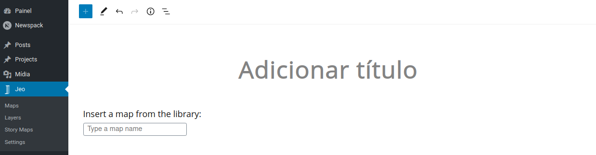
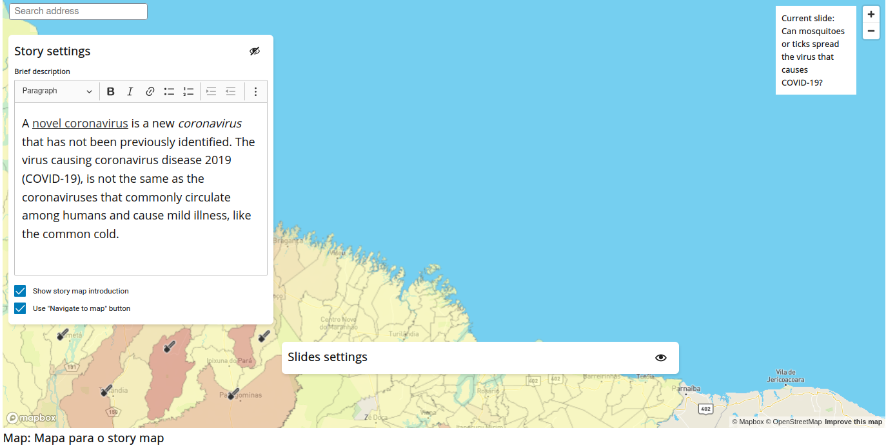
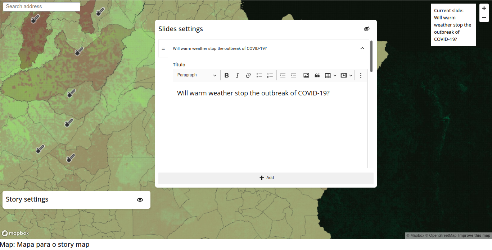
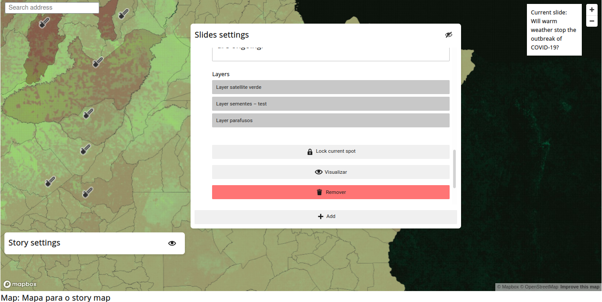
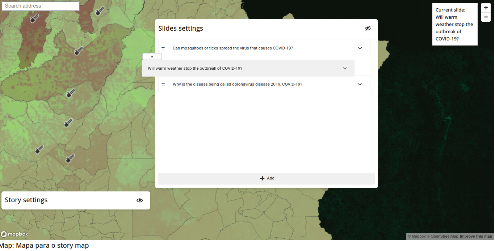
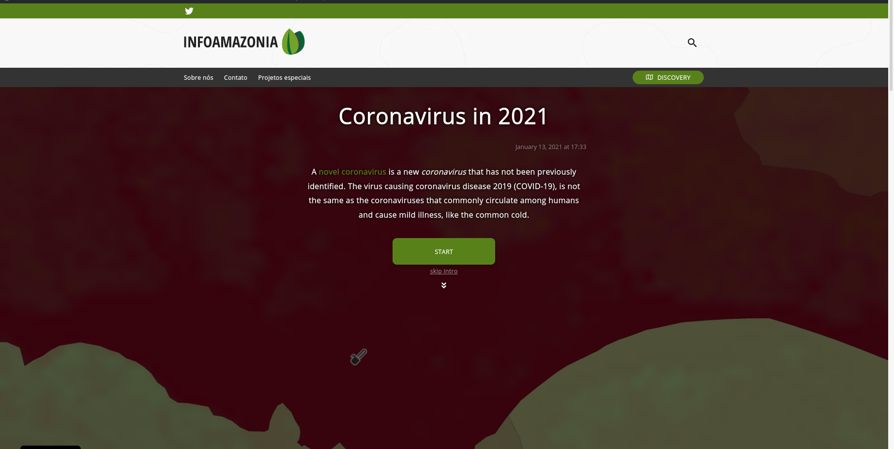
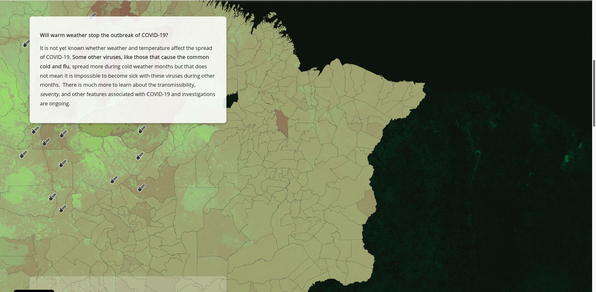
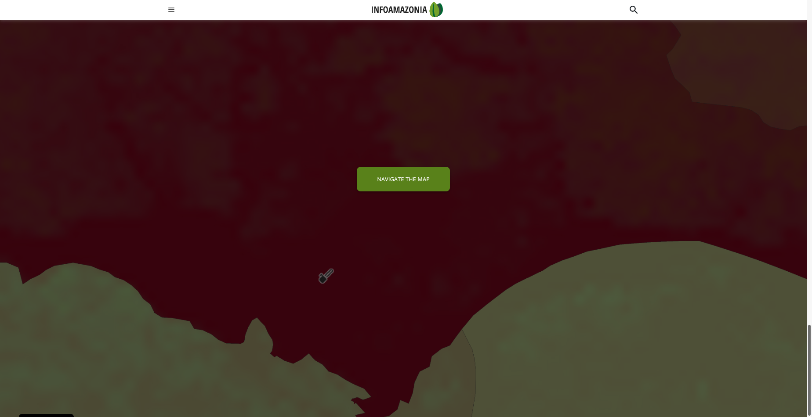
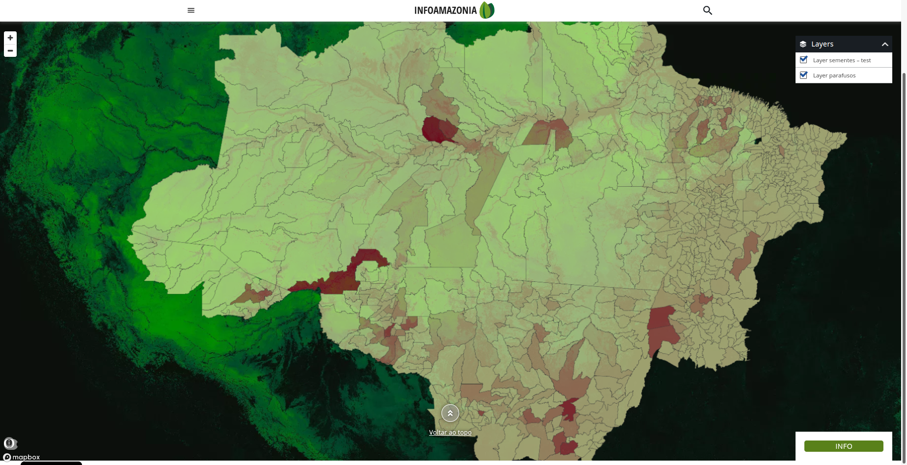

# Mapa narrativo

El Mapa Narrativo es una forma de crear narraciones interactivas con mapas y capas personalizados. Puedes seleccionar ubicaciones específicas y asociar capas y textos a estas ubicaciones. Esto generará un mapa que, al hacer scroll por la página, irá cambiando de una ubicación/capa/texto a otra. Este conjunto de ubicación, capa y texto se llama **Diapositiva**.

## Crear un Mapa Narrativo

El Mapa Narrativo es un tipo de contenido personalizado del plugin JEO. Al crear uno, se te pedirá un mapa. Todas las capas que vas a usar en tu Mapa Narrativo provienen de ese mapa previamente seleccionado. Además, el Mapa Narrativo tiene una `Navigate function`, de la que hablaremos más adelante. Esta función Navigate también usa el mapa seleccionado para funcionar.



### Configuración de la historia

Aquí puedes definir una descripción para tu mapa narrativo, que se mostrará al principio de la entrada, junto con el título y la fecha de publicación. También puedes definir si tu mapa narrativo tendrá o no una introducción y un `Navigate map button`.

**Todos los campos de texto tienen un Editor de Texto Enriquecido integrado. Esto significa que puedes poner texto en negrita, enlaces, listas, etc. dentro de tu campo de texto.**

El `Navigate map button` aparece al final de un Mapa Narrativo y permite al usuario navegar por el mapa. Este mapa seguirá toda la configuración del mapa previamente seleccionado.



### Configuración de las diapositivas

Una diapositiva de Mapa Narrativo contiene un título, contenido, ubicación y capas seleccionadas (el orden de las capas seguirá siempre el orden de las capas del mapa definido al crearlo). Puedes eliminar una diapositiva haciendo clic en el botón **Remover**, previsualizar el mapa de una diapositiva haciendo clic en el botón **Previsualizar** y fijar la ubicación de la diapositiva actual haciendo clic en el botón **Bloquear lugar actual**. Puedes ver cuál es la diapositiva actual en la parte superior derecha del bloque.

Puedes elegir la ubicación de una diapositiva arrastrando el mapa con el botón izquierdo del ratón y cambiar su inclinación y orientación arrastrando el mapa con el botón derecho.





Las diapositivas pueden reordenarse haciendo clic en el ícono `=` y arrastrándolo para colocar la diapositiva en otra posición.



## Viendo un Mapa Narrativo

Así se ve un Mapa Narrativo en una entrada:



Al hacer clic en **INICIAR**, el usuario irá a la primera diapositiva. Al hacer clic en **saltar introducción**, el usuario irá directamente al mapa para poder navegar por él (este botón solo está disponible si el ajuste de navegación está activado en la configuración del mapa narrativo). Estos botones, el título, la descripción y la fecha de publicación solo aparecen si `Shows story map introduction` está activado. Si no lo está, el mapa narrativo comienza en la primera diapositiva.



Mientras se hace scroll por la página, la diapositiva actual cambia a la siguiente y el mapa hace una transición hacia la siguiente ubicación y cambia sus capas. Al final de la narración, si el ajuste correcto está activado, aparecerá un botón **NAVEGAR EL MAPA**. Al hacer clic en él, el usuario accederá al mapa propiamente dicho y podrá interactuar con él.





## Integración con el tema

La salida pública del mapa narrativo incluye un contenedor de mapa estable para integraciones de temas:

```html
<div class="story-map-element jeo-storymap-map js-jeo-storymap-map"></div>
```

Los temas que necesiten posicionar o medir el mapa narrativo deben usar `jeo-storymap-map`
o `js-jeo-storymap-map` en lugar de clases del entorno de ejecución como `mapboxgl-map` o
`maplibregl-map`. Las clases de JEO están presentes antes de que se inicialice el entorno de ejecución del mapa,
mientras que las clases del entorno de ejecución las añade de forma asíncrona la biblioteca del mapa.
