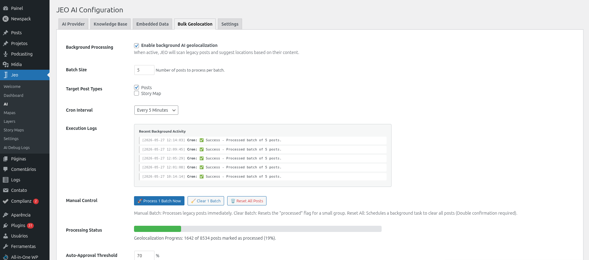
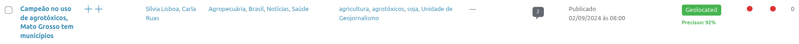
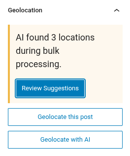
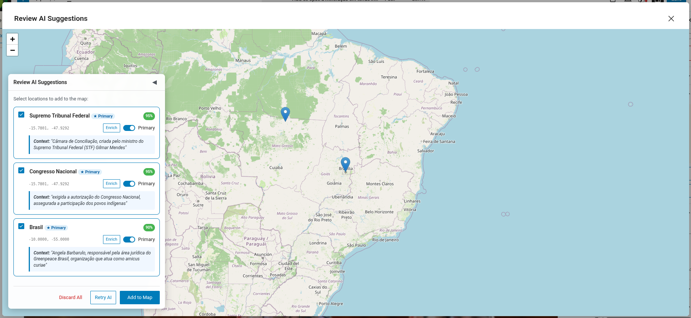

# Geolocalização em lote com IA

A Geolocalização em lote permite georreferenciar muitos posts de uma só vez usando IA. Isso é útil quando você tem um grande acervo de posts que não foram geolocalizados quando publicados.

## Como funciona

O sistema de Geolocalização em lote processa posts em lotes usando o cron do WordPress (WP-Cron). Ele seleciona posts que não têm dados de geolocalização (meta `_related_point`) e os envia para a IA analisar.

## Configuração

1. Configure um provedor de IA em **Jeo → IA** (veja [Configurações de IA](ai-settings.md)).
2. Vá para a aba **Geolocalização em lote** em **Jeo → IA**.
3. Selecione os tipos de post a processar, defina o limite de confiança e configure o tamanho do lote.
4. Inicie o processo em lote.

## Processamento

Depois de iniciado, o sistema processa os posts em segundo plano:

- Cada lote seleciona posts sem dados de geolocalização e os envia para a IA.
- Uma coluna **Status da IA do JEO** aparece na lista de posts do painel do WordPress, mostrando o status de georreferenciamento de cada post.
- Os posts processados são marcados para revisão — eles não são publicados automaticamente.

## Revisão dos resultados

Após o processamento, você pode revisar a geolocalização sugerida pela IA para cada post:

1. Vá para a lista de posts e procure posts com status da IA "aguardando aprovação".
2. Clique em um post para abrir o editor.
3. A barra lateral Geolocalização mostrará os pontos sugeridos pela IA.
4. Aprove ou ajuste os pontos conforme necessário.

Você também pode usar a **ação em lote** na lista de posts do WordPress (`edit.php`) para aprovar vários posts de uma vez. Selecione os posts, escolha **Aprovar geolocalizações da IA do JEO** no menu suspenso de ações em lote e um modal de pré-visualização será exibido, mostrando as localizações sugeridas de cada post, as pontuações de confiança e uma ação de aprovar/rejeitar.

## Monitoramento

- **Jeo → Logs de Debug da IA**: veja o uso de tokens, o provedor e o modelo de cada chamada à IA.
- A aba Geolocalização em lote mostra o progresso do lote atual e quaisquer erros encontrados.

## Requisitos

- Um provedor de IA deve estar configurado.
- Os posts devem ter título e/ou conteúdo para a IA analisar.
