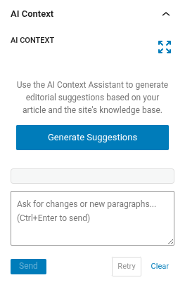
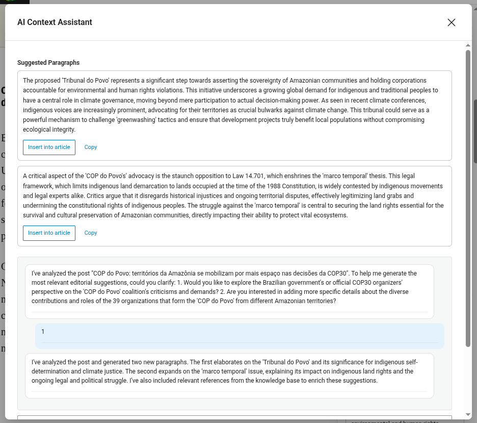

# Assistente de Contexto com IA — Sugestões editoriais

O Assistente de Contexto com IA é um painel lateral do Gutenberg que ajuda você a enriquecer seus artigos com parágrafos sugeridos por IA e referências a conteúdo relacionado da base de conhecimento do seu site.

Veja [IA no JEO](ai-in-jeo.md) para entender como o RAG, os agentes e a memória de conversa alimentam este recurso.

## Abrindo o painel

1. Abra ou crie um post no editor Gutenberg (o tipo de post deve estar ativado em **Configurações do JEO → Geral**).
2. Na barra lateral **Documento**, localize o painel **Contexto da IA**.
3. Se o painel estiver recolhido, clique no título para expandi-lo.

## Gerando sugestões

Clique em **Gerar sugestões**. A IA analisará o conteúdo do seu artigo e o arquivo vetorizado de artigos do site para produzir:

- **Parágrafos sugeridos** — blocos de texto prontos para inserir que complementam o seu artigo. Os parágrafos podem incluir formatação inline (negrito, itálico) e links para artigos relacionados.
- **Referências relacionadas** — artigos da sua base de conhecimento relevantes para o tema.

A geração **não é automática** — você controla quando ela acontece, para evitar chamadas desnecessárias à API.

## Usando os parágrafos sugeridos

Cada parágrafo sugerido tem duas ações:

### Inserir no artigo

Clique em **Inserir no artigo** para adicionar o parágrafo como um bloco `core/paragraph` do Gutenberg no final do documento. A formatação inline e os links são preservados. Depois de inserido, o botão muda para **Inserido**, para evitar duplicatas.

### Copiar

Clique em **Copiar** para copiar o parágrafo como texto rico (HTML com links) para a área de transferência. Você pode colá-lo em qualquer lugar — o editor do WordPress, Google Docs, Word, etc. A cópia usa um mecanismo com fallback triplo para máxima compatibilidade:

1. API moderna `ClipboardItem` (HTML + texto simples)
2. Seleção de DOM + `execCommand('copy')` (funciona em iframes do Gutenberg)
3. Somente texto simples (fallback universal)

## Refinando pelo chat

Após a geração inicial, você pode refinar as sugestões pela área de texto do chat:

- **"Deixe mais curto"** — condensa os parágrafos sugeridos.
- **"Foque no impacto ambiental"** — reescreve com um ângulo específico.
- **"Adicione mais contexto histórico"** — expande com informações adicionais.
- **"Inclua dados sobre a região amazônica"** — adiciona conteúdo específico da região.

Pressione **Ctrl+Enter** ou clique em **Enviar** para enviar sua mensagem.

### Tentar novamente

Clique em **Tentar novamente** para pedir à IA que gere novas sugestões sem precisar digitar uma mensagem. Útil quando você quer uma abordagem diferente para o mesmo tema.

### Limpar

Clique em **Limpar** para redefinir toda a conversa e remover todas as sugestões. Uma nova conversa começa do zero no próximo clique em "Gerar sugestões".

## Expandindo o painel

Clique no botão **expandir** (canto superior direito do painel) para abrir a interface de chat em um modal maior. Isso proporciona uma experiência melhor para conversas longas. O modal compartilha o mesmo estado do painel compacto.

## Persistência

Sua conversa é salva automaticamente. Se você fechar o painel, recarregar a página ou reabrir o editor mais tarde, seu histórico de chat e as últimas sugestões são restaurados.

## Personalizando o prompt da IA

Por padrão, o Assistente de Contexto usa um prompt do sistema integrado, otimizado para sugestões editoriais. Você pode personalizá-lo:

1. Vá para a aba **JEO → Configuração de IA → Assistente de Contexto**.
2. Marque **"Usar um prompt do sistema personalizado"**.
3. Edite o prompt na área de texto.
4. Salve as configurações.

Quando desmarcada, a aba mostra o prompt padrão em um campo somente leitura, para referência.

## Requisitos

- Um provedor de IA deve estar configurado em **Jeo → IA** (veja [Configurações de IA](ai-settings.md)).
- Para melhores resultados, indexe seus posts na Base de Conhecimento (aba **Jeo → IA → Base de Conhecimento**). O assistente usa RAG para encontrar artigos relacionados no arquivo vetorizado.
- O artigo deve ter pelo menos 100 caracteres de conteúdo antes que a IA possa gerar sugestões. Se o artigo for muito curto, o assistente pedirá que você escreva mais ou especifique o que deseja.
