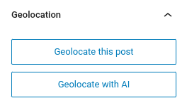
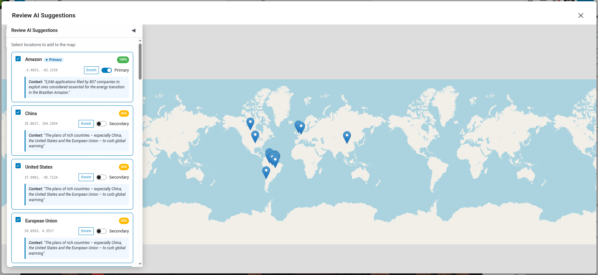
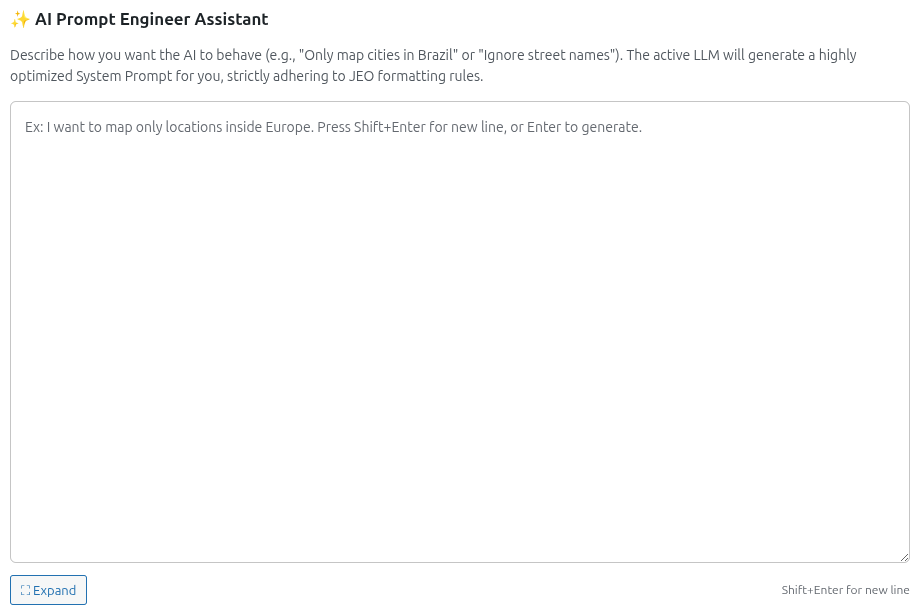
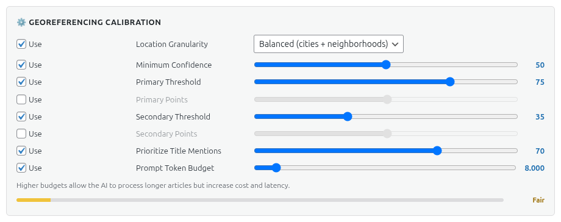

# Georreferenciamento com IA

O JEO pode georreferenciar seus posts automaticamente usando IA. Em vez de buscar e adicionar manualmente pontos de geolocalização, a IA analisa o conteúdo do seu post e sugere localizações relevantes com coordenadas e pontuações de confiança.

Veja [IA no JEO](ai-in-jeo.md) para uma visão geral de como o sistema de IA funciona.

## Como funciona

Ao editar um post, o painel lateral **Geolocalização** inclui um botão **Geolocalizar com IA**. Ao clicar nele, o título e o conteúdo do post são enviados para o provedor de IA configurado, que retorna pontos de geolocalização sugeridos.

### Fluxo

1. Clique em **Geolocalizar com IA** no painel lateral Geolocalização.
2. A IA analisa o conteúdo do post e identifica referências geográficas.
3. Os pontos sugeridos aparecem com o nome da localização, coordenadas e uma pontuação de confiança.
4. Revise e aprove ou ajuste os pontos sugeridos.
5. Os pontos são salvos como dados de geolocalização do post.

## Georreferenciamento com prompts personalizados

Em **Jeo → IA → Provedor de IA**, você encontrará a seção **Assistente de Engenharia de Prompt da IA**. Descreva como você quer que a IA se comporte (por exemplo, "Mapear apenas cidades do Brasil" ou "Ignorar nomes de ruas") e o LLM ativo gerará um prompt do sistema otimizado que incorpora suas definições de calibração. O prompt gerado pode ser revisado e editado antes do uso.

### Calibração

Em **Jeo → IA → Provedor de IA**, na seção **Calibração de georreferenciamento**, você pode ajustar finamente o comportamento do georreferenciamento:

- **Granularidade da localização**: controla o nível de detalhe geográfico — Ampla (países, regiões), Equilibrada (cidades + bairros) ou Fina (ruas, pontos de referência, POIs).
- **Confiança mínima**: pontuação de confiança mínima para que um ponto seja sugerido (0–100).
- **Limite principal**: pontuação de confiança acima da qual uma localização é classificada como PRIMÁRIA (foco geográfico principal).
- **Pontos principais**: número máximo de localizações PRIMÁRIAS que a IA pode sugerir.
- **Limite secundário**: intervalo de pontuação de confiança para localizações SECUNDÁRIAS (mencionadas, mas não centrais).
- **Pontos secundários**: número máximo de localizações SECUNDÁRIAS que a IA pode sugerir.
- **Priorizar menções no título**: o quanto o título do post influencia a detecção de localizações pela IA (0–100%).
- **Tokens máximos**: orçamento de tokens para o prompt do sistema gerado.

Cada configuração tem uma alternância **Usar** — desative-a para excluir aquela regra do prompt da IA.

## Refinamento em várias interações

Após o georreferenciamento inicial, você pode conversar com a IA para refinar os resultados. Por exemplo, você pode pedir para adicionar uma cidade específica, remover um ponto incorreto ou ajustar a confiança de uma sugestão.

O histórico da conversa é preservado por post, então você pode continuar refinando em sessões de edição posteriores.

## Requisitos

- Um provedor de IA deve estar configurado em **Jeo → IA** (veja [Configurações de IA](ai-settings.md)).
- O post deve ter um título e/ou conteúdo para a IA analisar.
