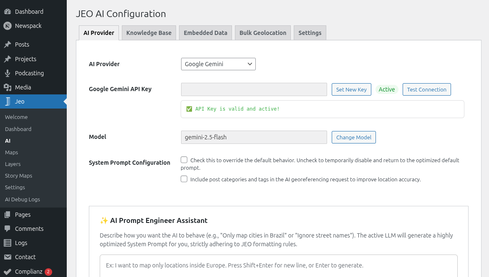
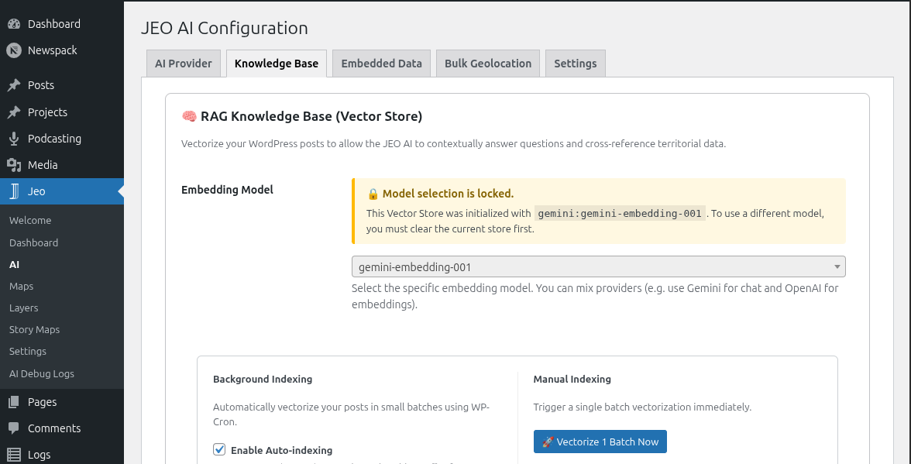

# Configurações de IA

O JEO inclui capacidades de IA integradas para georreferenciar posts, gerar mapas e criar camadas de mapa personalizadas. Antes de usar esses recursos, você precisa configurar um provedor de IA.

Veja [IA no JEO](ai-in-jeo.md) para uma visão geral da arquitetura de IA e de como cada peça funciona.

## Configurando um provedor de IA

Navegue até **Jeo → IA** no painel do WordPress. A página de configurações é organizada em abas:

### Aba Provedor de IA

Selecione um dos 10 provedores de IA com suporte e insira sua chave de API:

| Provedor | Requer chave de API |
|----------|-----------------|
| Google Gemini | Sim |
| OpenAI | Sim |
| DeepSeek | Sim |
| Anthropic | Sim |
| Ollama | Não (local) |
| Mistral | Sim |
| ZAI | Sim |
| HuggingFace | Sim |
| Grok | Sim |
| Cohere | Sim |

Depois de selecionar um provedor e inserir a chave, clique em **Testar conexão** para verificar se está funcionando.

### Aba Base de Conhecimento

A Base de Conhecimento (RAG) armazena versões vetorizadas dos seus posts e camadas, permitindo que a IA pesquise conteúdo contextualmente relevante ao georreferenciar ou gerar mapas.

- **Modelo de Embedding**: escolha um modelo de embedding do seu provedor (ou use o Ollama localmente).
- **Indexação automática**: indexa automaticamente, em segundo plano, posts e camadas novos ou atualizados.
- **Tamanho do lote**: número de itens processados por ciclo de indexação.
- **Intervalo do Cron**: com que frequência a indexação em segundo plano é executada.
- **Resultados da busca (topK)**: número máximo de correspondências semânticas retornadas por busca (1–50, padrão 10).
- **Ações**: dispare manualmente a indexação de posts ou camadas, faça backup/restaure o armazenamento de vetores ou limpe-o.

### Aba Dados incorporados

O JEO vem com dicionários geográficos brasileiros integrados (biomas, unidades de conservação, terras indígenas, bacias hidrográficas e mais). Eles ajudam a IA a reconhecer referências geográficas no seu conteúdo. Esta aba mostra quais dicionários estão carregados.

### Aba Geolocalização em lote

Configure as definições de geolocalização em lote para processar muitos posts de uma só vez. Veja [Geolocalização em lote com IA](ai-bulk-geolocation.md) para detalhes.

### Aba Assistente de Contexto

Personalize o prompt do sistema usado pelo [Assistente de Contexto com IA](ai-context-assistant.md) — o painel lateral de sugestões editoriais no editor Gutenberg.

- **Usar prompt personalizado**: marque esta caixa para substituir o prompt padrão integrado pelo seu próprio.
- **Prompt personalizado**: área de texto editável para o seu prompt do sistema personalizado. Quando desmarcada, a aba mostra o prompt padrão em um campo somente leitura, para referência.

Deixe o prompt personalizado vazio para usar o padrão integrado, que é otimizado para assistência editorial jornalística com integração RAG.

## Saída estruturada

Quando ativada (padrão), a IA retorna resultados em um formato JSON estrito imposto pelo provedor. Isso melhora a precisão do georreferenciamento e da geração de mapas. Você pode desativá-la nas configurações de IA se o seu provedor não oferecer suporte.

## Acompanhamento de custos

O JEO rastreia o uso da IA em **Jeo → Logs de Debug da IA**. Cada entrada de log registra o provedor, o modelo, os tokens de entrada/saída, além do prompt e da resposta. Use isso para monitorar custos e solucionar problemas nas respostas.
