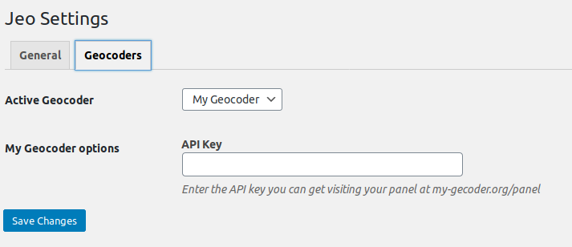

# Escrevendo um geocodificador

Um geocodificador é um serviço que encontra coordenadas geográficas a partir de uma busca por informações de endereço. Ele também é capaz de obter detalhes do endereço com base nas coordenadas geográficas, o que é chamado de geocodificação reversa.

O JEO precisa de um serviço de geocodificação em algumas situações, como quando os usuários indicam a que local de um mapa uma história (post) está relacionada.

O JEO vem com o Nominatim como seu geocodificador nativo. Geocodificadores adicionais podem ser adicionados por plugins através do hook `jeo_register_geocoders`. Esta página documenta como fazer isso.

## Registrando um geocodificador

Associe uma função à ação `jeo_register_geocoders` e chame o registro com o seguinte código:

```php
add_action('jeo_register_geocoders', function($geocoders) {

    $geocoders->register_geocoder([
        'slug' => 'my-geocoder',
        'name' => 'My Geocoder',
        'description' => __('My Geocoder description', 'my-textdomain'),
        'class_name' => 'MyGeocoderClass'
    ]);

});
```

Isso informará ao JEO que há um novo serviço de geocodificação disponível e fornecerá algumas informações sobre ele.

- O nome e a descrição serão usados no painel de administração para que o administrador possa reconhecer os geocodificadores disponíveis e escolher qual deles será usado.
- slug precisa ser um identificador único para o geocodificador
- class_name é o nome da classe do geocodificador

## Criando a classe do geocodificador

Agora precisamos criar a classe do geocodificador. Ela será uma classe que estende `\Jeo\Geocoder` e implementa alguns métodos que fazem a geocodificação de fato.

Dentro do mesmo hook, declare a classe e dois métodos obrigatórios:

- `geocode($search_string)` O método que recebe a string de busca, faz a requisição aos servidores do geocodificador e retorna as coordenadas e os detalhes do endereço;
- `reverse_geocode($lat, $lon)` O método que recebe latitude e longitude, faz a requisição ao servidor do geocodificador e retorna todos os detalhes da localização no mesmo formato que o método `geocode`.

Enquanto `geocode()` retorna um array de resultados de busca, `reverse_geocode()` retorna apenas um resultado.

Cada resultado é um array que deve conter apenas as chaves esperadas pelo plugin JEO, de modo que cada geocodificador deve encontrar a melhor correspondência entre cada campo e os campos esperados pelo JEO.

Observação: apenas `lat` e `lon` são obrigatórios.

Exemplo de resposta com todos os campos aceitos:

```php
[
        [
            'lat' => '',
            'lon' => '',
            'full_address' => '',
            'country' => '',
            'country_code' => '',
            'region_level_1' => '',
            'region_level_2' => '', // State goes here
            'region_level_3' => '',
            'city' => '',
            'city_level_1' => '',
        ]
]
```

Aqui está um exemplo simples:

```php
add_action('jeo_register_geocoders', function($geocoders) {

    $geocoders->register_geocoder([
        'slug' => 'my-geocoder',
        'name' => 'My Geocoder',
        'description' => __('My Geocoder description', 'my-textdomain'),
        'class_name' => 'MyGeocoderClass'
    ]);

    class MyGeocoderClass extends \Jeo\Geocoder {

        public function geocode($search_string) {

            $params = [
                'q' => $search_string,
                'format' => 'json',
                'addressdetails' => 1
            ];

            $r = wp_remote_get( add_query_arg($params, 'https://my-geocoder-server.org/search') );

            $data = wp_remote_retrieve_body( $r );

            $data = \json_decode($data);
            $response = [];

            if (\is_array($data)) {

                foreach ($data as $match) {
                    $r = $this->format_response_item( (array) $match );
                    if ($r) $response[] = $r;
                }

            }

            return $response;

        }

        public function reverse_geocode($lat, $lon) {

            $params = [
                'lat' => $lat,
                'lon' => $lon,
                'format' => 'json',
                'addressdetails' => 1
            ];

            $r = wp_remote_get( add_query_arg($params, 'https://my-geocoder-server.org/reverse') );

            $data = wp_remote_retrieve_body( $r );

            $data = \json_decode($data);

            return $this->format_response_item( (array) $data );

        }

        private function format_response_item($match) {

            $response = [
                'lat' => $match['lat'],
                'lon' => $match['lon'],
                'full_address' => $match['display_name'],
                'country' => $match['country'],
                'country_code' => $match['country_code'],
                'region_level_1' => $match['region_level_1'],
                'region_level_2' => $match['region_level_2'], // State goes here
                'region_level_3' => $match['region_level_3'],
                'city' => $match['city'],
                'city_level_1' => $match['city_level_1'],
            ];

            return $response;

        }

    }

});
```

E é só isso! Seu novo geocodificador está pronto!

## Adicionando configurações adicionais ao geocodificador

Alguns serviços de geocodificação podem precisar ou oferecer configurações adicionais. Alguns podem exigir que o usuário insira sua chave de API, outros podem permitir que os usuários restrinjam a busca a um país específico para obter melhores resultados ao pesquisar.

Você também pode adicionar facilmente novas configurações ao seu geocodificador, e elas serão automaticamente apresentadas ao usuário na página de Configurações.

Declare um método `get_settings()` na sua classe que retornará um array com todas as configurações que o seu geocodificador aceita.

Cada configuração é descrita por um array com as seguintes chaves:

- `slug`: um slug para a sua opção. Você não precisa se preocupar com conflitos de nomenclatura, ela será armazenada dentro das opções do seu geocodificador;
- `name`: um nome legível por humanos;
- `description`: uma explicação ao usuário sobre o que é esta configuração.

Vamos ver um exemplo apenas com o código relevante:

```php
add_action('jeo_register_geocoders', function($geocoders) {

    // ...
    class MyGeocoderClass extends \Jeo\Geocoder {

        // ...

        public function get_settings() {

            // Note it is an array of arrays
            return [
                [
                    'slug' => 'api_key',
                    'name' => __('API Key', 'my-text-domain'),
                    'description' => __('Enter the API key you can get visiting your panel at my-gecoder.org/panel', 'my-text-domain')
                ]
            ];

        }

    }

});
```

E isto é o que você verá no painel de administração:



## Acessando valores das configurações

Agora que você registrou uma configuração e o usuário pode alterar o valor dela no painel de administração, você pode usá-la no seu geocodificador.

Para obter o seu valor, basta chamar `$this->get_option($option_name)`.

Exemplo:

```php
// ...

        // ...

        public function geocode($search_string) {

            $params = [
                'q' => $search_string,
                'format' => 'json',
                'addressdetails' => 1,
                'api_key' => $this->get_option('api_key')
            ];

            // ...

            return $response;

        }

// ...
```

## Declarando valores padrão

Você também pode adicionar o método `get_default_options()` à sua classe para definir valores padrão para cada configuração. Isto é opcional e é feito assim:

```php
add_action('jeo_register_geocoders', function($geocoders) {

    // ...
    class MyGeocoderClass extends \Jeo\Geocoder {

        // ...

        public function get_default_options() {

            return [
                'api_key' => 'sand-box-api-key' // the key must match the slug of the setting registered in get_settings()
            ];

        }

    }

});
```

## Avançado: personalização ainda maior das configurações

Se o seu geocodificador precisar de configurações especiais que um simples campo de texto não consegue atender, há mais um método que você pode declarar para adicionar código HTML arbitrário à página de Configurações.

`settings_footer($settings)` deve fazer echo de um código HTML que será renderizado no final da página de configurações do seu geocodificador.

Ele recebe o objeto `$settings`, que é uma instância de `\Jeo\Settings` e possui alguns helpers que você pode usar.

Você só precisa imprimir os campos do formulário com os nomes corretos, e o JEO cuidará de salvá-los para você.

Para obter o nome correto do campo, use `$settings->get_geocoder_option_field_name($name)`.

Exemplo:

```php
// ...

        // ...

        public function settings_footer($settings) {

            ?>
            <p><strong>My Select option</strong></p>

            <select name="<?php echo $settings->get_geocoder_option_field_name('new_option'); ?>">
                <option value="yes" <?php selected( $this->get_option('new_option'), 'yes' ); ?> >
                    Yes
                </select>
                <option value="no" <?php selected( $this->get_option('new_option'), 'no' ); ?> >
                    No
                </select>
            </select>
            <?php

        }

// ...
```

Observação: `selected()` é uma função nativa do WordPress. Consulte a [documentação oficial](https://developer.wordpress.org/reference/functions/selected/)
