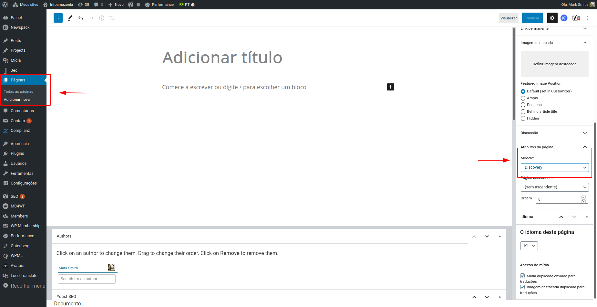
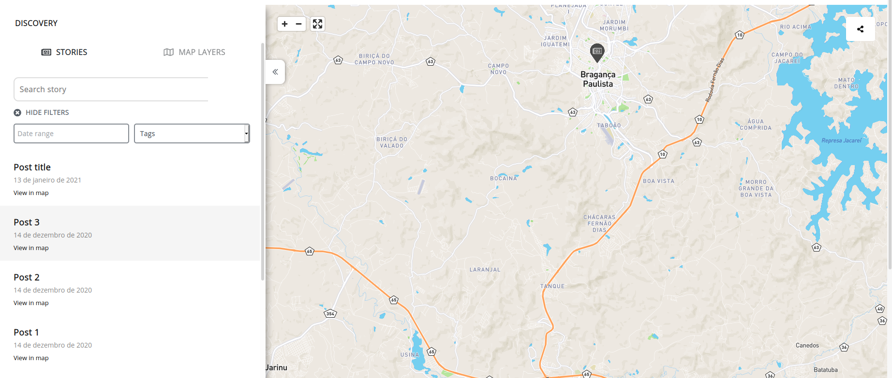
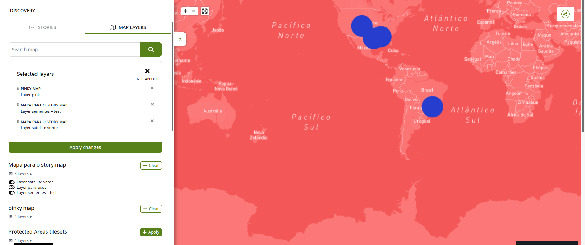
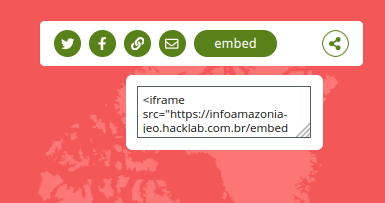

# Discovery

A página Discovery é um mapa interativo onde o usuário pode adicionar camadas, ver histórias baseadas em posts geolocalizados publicados e compartilhar o seu próprio mapa personalizado com outras pessoas.
A página Discovery tem uma barra lateral à esquerda com duas abas: **HISTÓRIAS** e **CAMADAS DO MAPA**. Você pode ocultar essa barra lateral clicando no ícone de duas setas para a esquerda, à direita da barra lateral.

## Como criar uma página Discovery

Para criar uma página Discovery, você só precisa criar uma página normal do WordPress e selecionar `Discovery` nas configurações de Modelo.

Qualquer conteúdo adicionado a essa página será ignorado, e a página exibirá apenas a funcionalidade Discovery.

## Histórias

As histórias são os posts geolocalizados exibidos no mapa. Clicar em `EXIBIR FILTROS` permite filtrar essas histórias por data e tags. Abaixo desses filtros, será exibida uma lista com os resultados. Cada resultado também é um link para a própria história. Além disso, passar o mouse sobre um marcador do mapa destaca a história relacionada na barra lateral esquerda. Da mesma forma, passar o mouse sobre o texto `Ver no mapa` destaca o marcador do mapa correspondente.

## Camadas do mapa

Na aba Camadas do mapa, você pode buscar mapas e aplicar as camadas deles ao seu mapa interativo. Você pode filtrar mapas por nome e selecionar diferentes camadas de diferentes mapas. Após selecionar pelo menos uma camada de um mapa, você pode clicar em `Limpar` para remover todas as camadas selecionadas desse mapa antes de aplicar as mudanças. Também é possível adicionar todas as camadas de um mapa com um único clique, selecionando **Aplicar** ao lado de um resultado de mapa.

No topo da barra lateral, você poderá ver todas as camadas selecionadas, podendo remover algumas delas. Essas camadas sempre têm uma função de arrastar e soltar, para que você possa reordená-las. Após revisar essas camadas, é preciso clicar em `Aplicar mudanças` para exibi-las no mapa do Discovery.

## Compartilhamento

No canto superior direito do mapa, há um botão de compartilhamento onde você pode compartilhar o conteúdo no **Twitter**, no **Facebook**, por **E-mail** ou até gerar um link personalizado para o seu mapa. Além disso, ao clicar em `embed`, um popup é exibido com um código HTML para incorporar o seu mapa personalizado em outro site.

