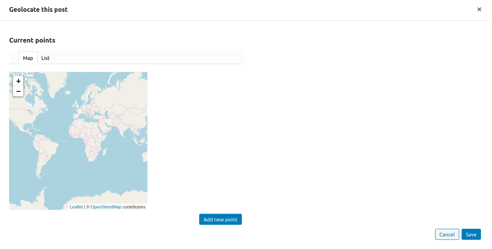
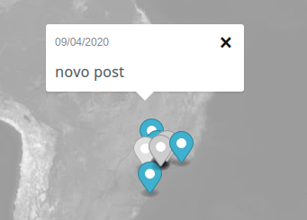

# Geolocalização de posts

Ao editar um post, o JEO adiciona um painel extra à barra lateral: **Geolocalização**. Ao clicar em **Geolocalizar este post**, um popup será exibido.

Novos pontos podem ser adicionados ao post clicando no botão **Adicionar novo ponto**. Você pode pesquisar um local específico na barra de pesquisa.

Também é possível escolher a relevância de cada ponto, o que é útil quando você tem mais de um ponto.

## Visualizando um mapa com posts geolocalizados

Mapas com posts geolocalizados contêm marcadores na localização de cada post. Ao clicar neles, um popup será aberto com o título e a data de publicação. Ao clicar no título, você será levado ao próprio post.

## Georreferenciamento por IA

Como alternativa, o JEO pode georreferenciar posts automaticamente usando IA. A IA analisa o conteúdo do post e sugere pontos de geolocalização com pontuações de confiança. Você pode então revisar e aprovar as sugestões. Consulte [Georreferenciamento por IA](ai-georeferencing.md).

Para processar muitos posts de uma só vez em lote, consulte [Geolocalização em lote com IA](ai-bulk-geolocation.md).
