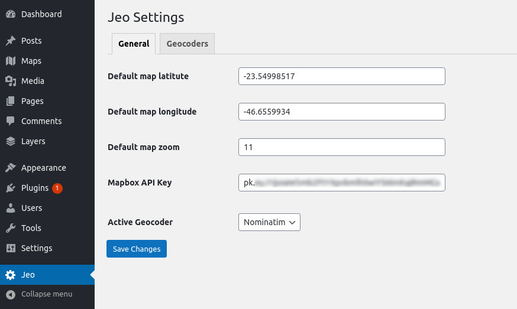
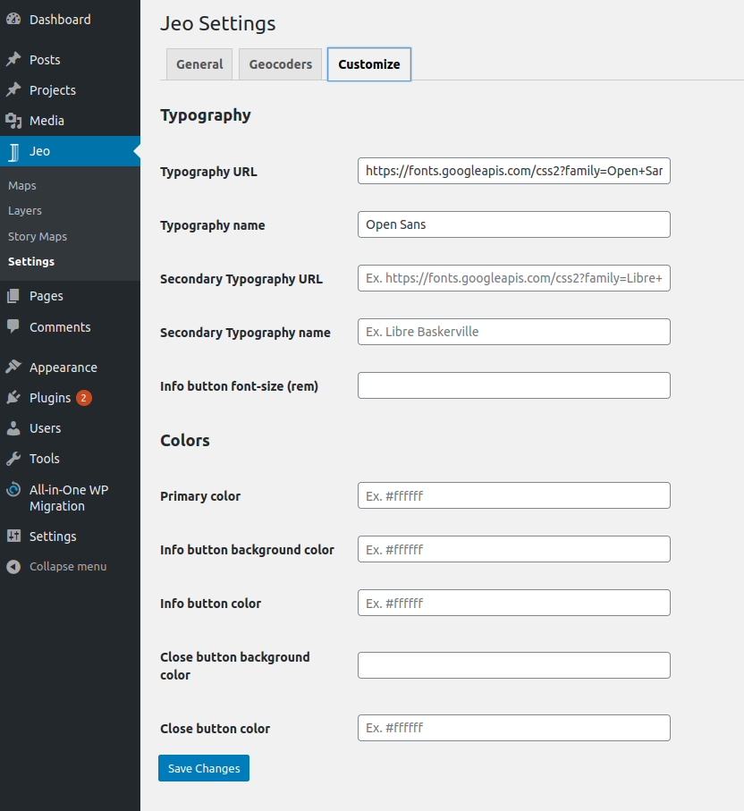
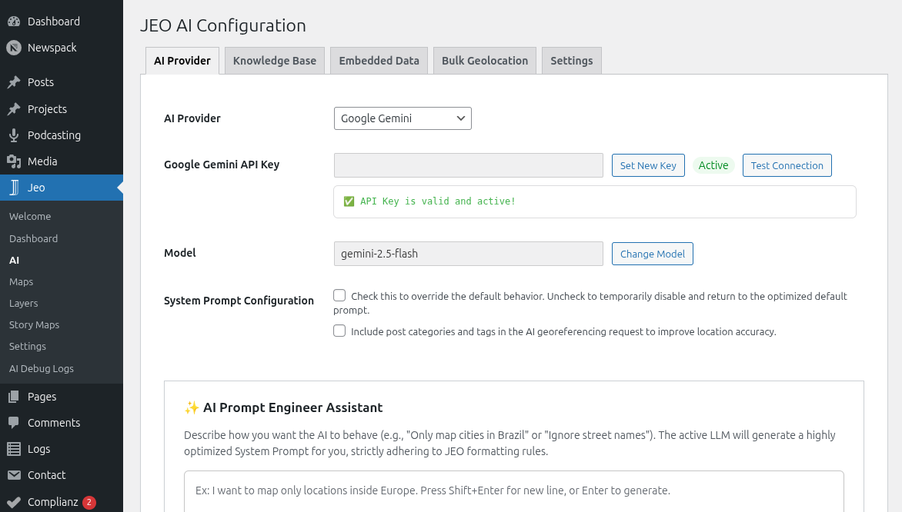

# Primeiros passos

## Instalação

Após ativar o plugin, um novo item aparecerá no painel do WordPress: o menu **Jeo**, contendo:

- **Mapas** — Crie e gerencie posts de mapas interativos
- **Camadas** — Crie e gerencie posts de camadas de dados
- **Mapas Narrativos** — Crie experiências de mapa com scrollytelling
- **IA** — Configure provedores de IA, base de conhecimento e geolocalização em lote
- **Configurações** — Configurações gerais de mapa, geocodificador e estilo

## Configurando o plugin

No menu principal do JEO, em **Jeo → Configurações**, você pode configurar:

* a latitude, a longitude e o zoom padrão dos seus mapas;
* as [configurações da API do Mapbox](https://docs.mapbox.com/help/how-mapbox-works/access-tokens/) que serão usadas pelo plugin;
* o geocodificador que será usado pelo plugin — atualmente, o [Nominatim](https://nominatim.openstreetmap.org/) é a opção integrada, com extensibilidade para outros geocodificadores via hook.
* o estilo de algumas funcionalidades do plugin, como fontes e cores.

## Configurando as funcionalidades de IA

Em **Jeo → IA**, você pode configurar as funcionalidades com IA:

* Selecione um provedor de IA (Google Gemini, OpenAI, DeepSeek, Anthropic, Ollama, Mistral, entre outros) e insira a chave de API.
* Configure a Base de Conhecimento (RAG) para indexar seus posts e camadas e obter resultados de IA mais inteligentes.
* Configure a geolocalização em lote para processar posts em lotes.

Veja [Configurações de IA](ai-settings.md) para instruções detalhadas.

