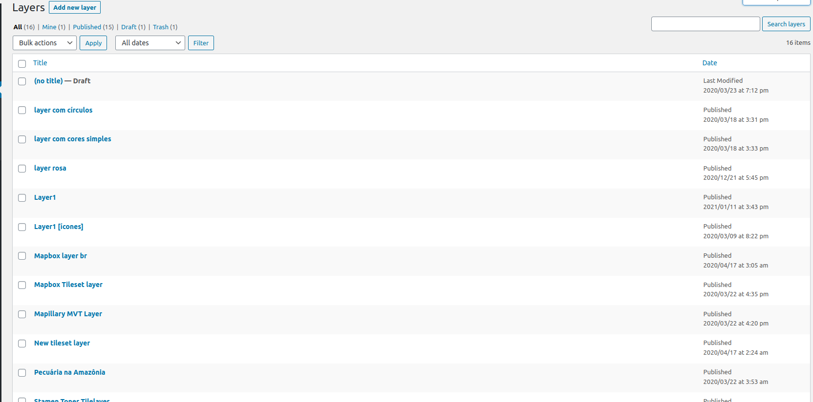
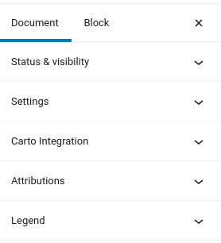
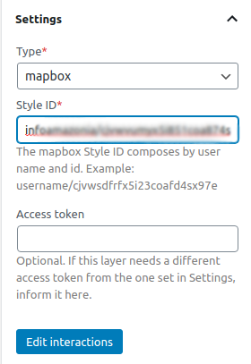
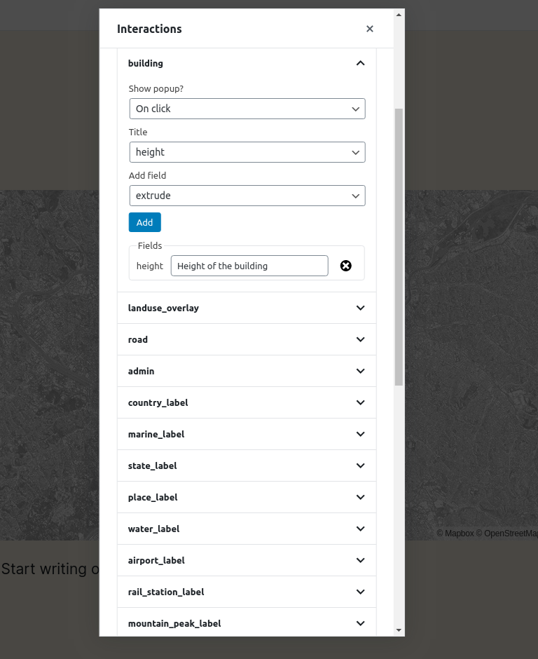
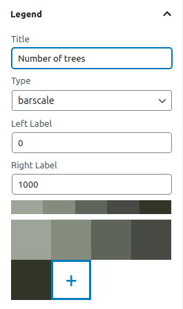

# Criando uma camada

Um dos tipos de post personalizados que o plugin JEO fornece é **Camada**. As camadas são onde você adiciona legendas, cores e fontes de dados aos seus mapas. Um mapa pode conter uma ou mais camadas.

Ao entrar no editor do post de camada, você verá uma prévia da camada atual (ou de uma camada padrão, se a camada atual ainda não tiver sido editada) e três painéis na barra lateral: **Configurações**, **Atribuições** e **Legenda**.

## Configurações da camada

No painel **Configurações da camada**, você pode alterar o tipo da camada.

O JEO suporta sete tipos de camada prontos para uso:

| Tipo | Campos obrigatórios | Campos opcionais | Ideal para |
|------|-----------------|-----------------|----------|
| [Estilos do Mapbox](https://docs.mapbox.com/studio-manual/overview/map-styling/) | ID do estilo (`username/style-id`) | Token de acesso | Mapas completos e estilizados criados no Mapbox Studio |
| [Style JSON](https://maplibre.org/maplibre-style-spec/) | URL do estilo ou JSON de estilo embutido | — | Estilos públicos do MapLibre GL; funciona sem chave de API |
| [Tilesets do Mapbox](https://docs.mapbox.com/help/glossary/tileset/) (raster) | ID do tileset (`username.tilesetid`) | Token de acesso | Dados raster hospedados no Mapbox |
| [Tilesets vetoriais do Mapbox](https://docs.mapbox.com/vector-tiles/reference/) | ID do tileset, source layer | Token de acesso | Dados vetoriais hospedados no Mapbox |
| [Vector tiles do Mapbox](https://docs.mapbox.com/vector-tiles/reference/) (MVTs) | URL do tileset, source layer, tipo de geometria | Token de acesso | Dados vetoriais com recursos interativos |
| [GeoJSON](https://geojson.org/) | URL do GeoJSON ou GeoJSON embutido | Estilo da camada | Dados de polígonos renderizados no cliente, incluindo camadas de limites geradas por IA |
| [TileLayers](https://en.wikipedia.org/wiki/Tiled_web_map) | Modelo de URL de tile (`https://.../{z}/{x}/{y}.png`) | — | Servidores de tiles de terceiros (URLs XYZ) |

Se o campo **Token de acesso** for deixado vazio, a camada usará a chave de API do Mapbox configurada em **Jeo → Configurações**. Você só precisa preencher esse campo quando a camada exigir um token diferente do token global.

Também há um botão **Editar interações**. Nele, você pode adicionar popups à sua camada quando ações específicas são realizadas (clicar ou passar o mouse) (ex.: clicar em um edifício e exibir a sua altura).

## Legenda da camada

No painel **Legenda da camada**, você pode adicionar legendas à sua camada (barscale, simple-color, icons ou circles) e personalizar as suas cores.

## Atribuições

Aqui é onde você dá os créditos da camada, definindo um link para baixá-la ou acessar mais informações sobre ela. Essas atribuições serão exibidas na parte inferior do mapa e dentro do popup que aparece quando o botão `INFO` é clicado em um mapa.
