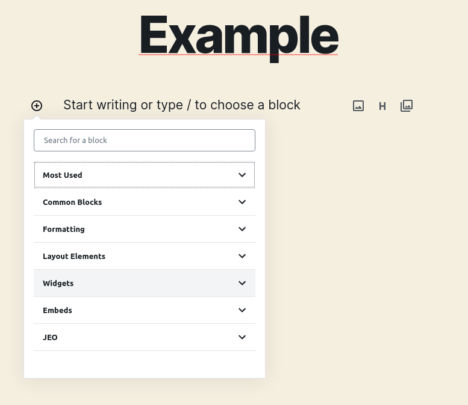
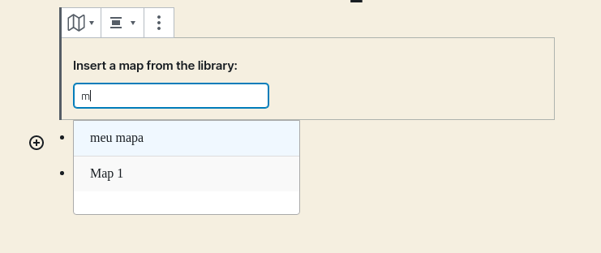
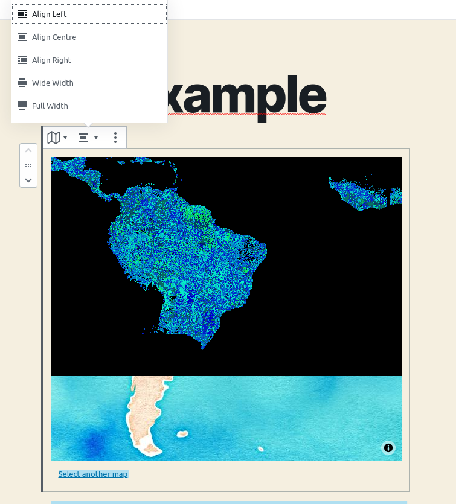
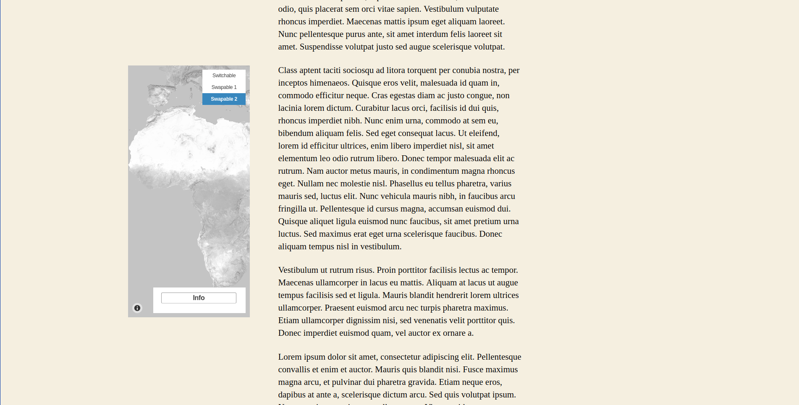
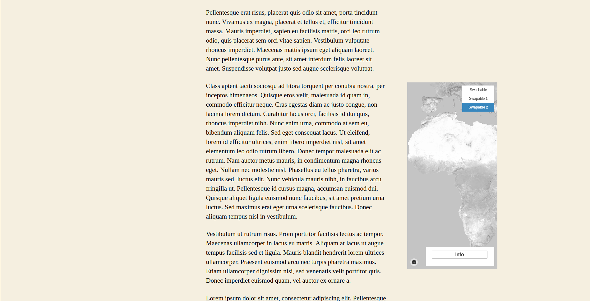
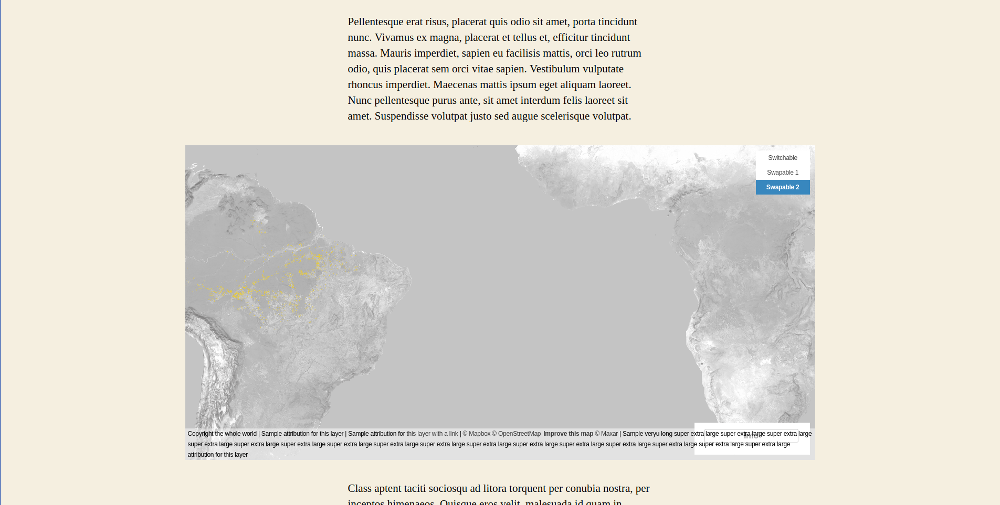
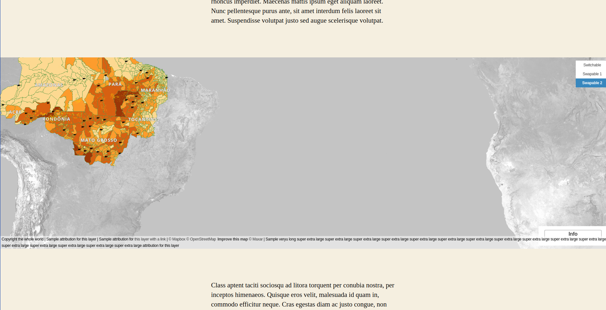
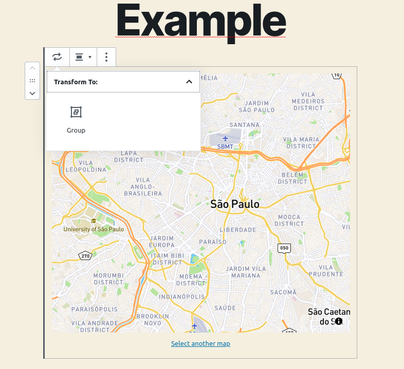
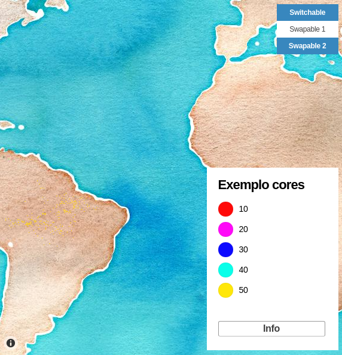
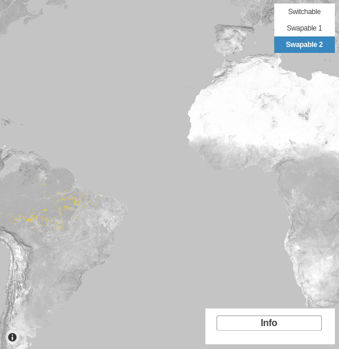

# Bloco de mapa

Após [criar mapas](map-post.md), você pode exibi-los dentro de qualquer post usando o bloco **Mapa JEO**.

## Adicionando um mapa a um post

Ao criar um novo post, você encontrará uma nova categoria de blocos: **JEO**.

Selecione o bloco **Mapa JEO** e pesquise por qualquer mapa que você tenha criado.

### Opções de alinhamento

Com um mapa selecionado, você pode escolher um alinhamento:

| Alinhamento | Descrição |
|-------------|-------------|
| Centro | Padrão. O mapa fica centralizado na área de conteúdo |
| Esquerda | O mapa flutua à esquerda com o texto ao redor |
| Direita | O mapa flutua à direita com o texto ao redor |
| Largura ampla | O mapa se estende além da área de conteúdo |
| Largura total | O mapa ocupa toda a largura da página |

## Agrupando mapas

Além da opção de alinhamento, há também uma funcionalidade de agrupamento disponível para organizar vários mapas juntos.

## Alternância de camadas

Se o seu mapa tiver mais de uma camada, você pode alterná-las e selecionar qual deseja ver, dependendo das configurações das camadas do mapa. [Saiba mais sobre camadas de mapa aqui](layer-post.md)

