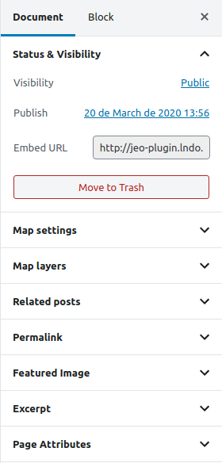
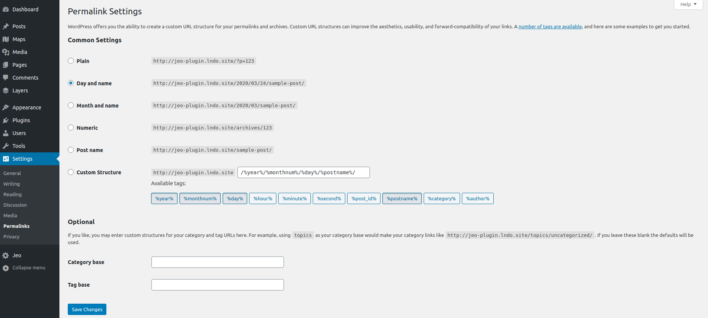

# Incorporação de mapa

O plugin JEO permite inserir um mapa em um post colando um link no editor. Isso é o que se chama de `Embed map` (incorporação de mapa) e é muito fácil de fazer.

Ao editar um [Mapa](map-post.md), um dos painéis de configurações é o `Status & visibilidade`. Nele você encontra a `URL de incorporação` daquele mapa específico.

Copiar esse link e colá-lo no editor de posts resultará em um mapa incorporado.

**Atenção**: se o seu post exibir um erro *Not Found*, siga estas etapas:

- Vá para o painel do WordPress > Configurações > Links permanentes
- Altere as Configurações comuns (você pode mudar para uma configuração diferente e depois voltar para a original) e clique em `Salvar alterações`

Agora você deveria conseguir ver os mapas incorporados sem problemas.
