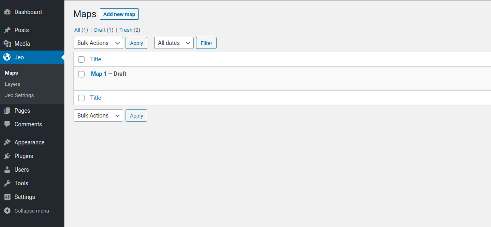
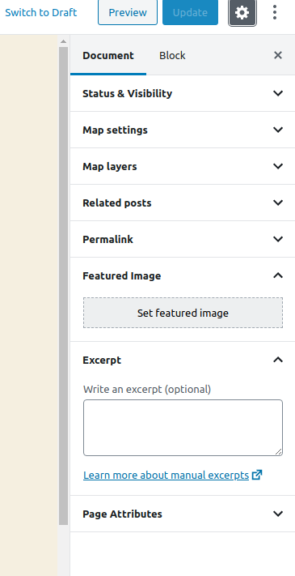
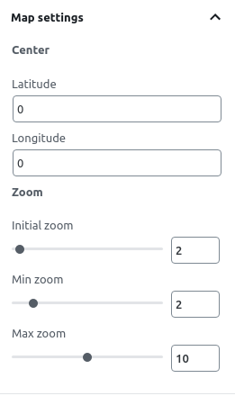
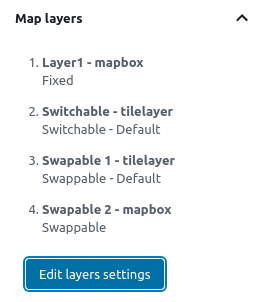
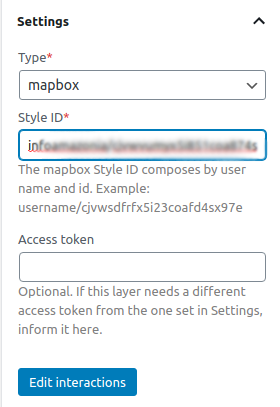
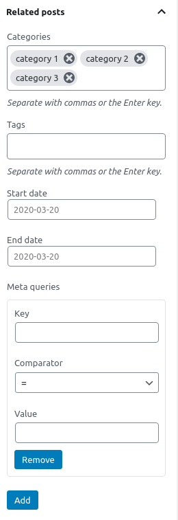

# Criando mapas

Um dos tipos de post personalizados que o plugin JEO fornece é **Mapa**.

Ao entrar no editor do post de mapa, você verá uma prévia do mapa atual (ou de um mapa padrão, se nenhuma camada estiver selecionada) e três painéis na barra lateral: **Configurações do mapa**, **Camadas do mapa** e **Posts relacionados**.

## Configurações do mapa

No painel **Configurações do mapa**, você pode alterar o centro inicial do mapa definindo uma latitude e uma longitude. Você também pode alterar as configurações padrão de zoom ou até desativá-lo.

Ao visualizar um mapa em um post, clicar com o botão direito do mouse e arrastar faz o mapa girar. Rolar a roda do mouse altera o zoom do mapa. Ambas as opções podem ser ativadas ou desativadas com as caixas de seleção.

## Camadas do mapa

No painel **Camadas do mapa**, você pode visualizar todas as camadas que fazem parte do mapa.

Clicar em **Editar configurações de camadas** abre um popup. Nele, você pode adicionar, remover e reordenar camadas, definir os seus tipos e se as suas legendas serão exibidas no mapa. Você também pode carregar interações específicas para cada camada clicando em `Carregar interações`.

### Tipos de legenda

A legenda de cada camada pode ser definida como um destes tipos:

- **Fixo**: A camada está sempre visível. Boa para camadas de referência de base.
- **Alternável**: O usuário pode ativar e desativar a camada de forma independente. Boa para sobreposições opcionais.
- **Substituível**: Apenas uma camada substituível fica visível por vez (comportamento de botões de opção). Boa para comparar conjuntos de dados diferentes.

### Estilo de camada

Alguns tipos de camada suportam estilização personalizada. Ao usar **vector tiles do Mapbox** com geometria `fill`, `line` ou `circle`, um editor de estilo permite personalizar cores, opacidade e filtros. Camadas geradas por IA também vêm com um estilo padrão sugerido que você pode aceitar ou substituir. Outros tipos de camada (estilos do Mapbox, tilesets, TileLayers) usam a estilização definida em sua origem.

[Veja como criar novas camadas aqui](layer-post.md)

## Posts relacionados

No painel **Posts relacionados**, você pode definir quais posts geolocalizados serão usados como marcadores no mapa. Você pode filtrar posts por categorias, tags, intervalo de datas ou — para usos avançados — consultas de meta usando o `post_meta` do WordPress.

