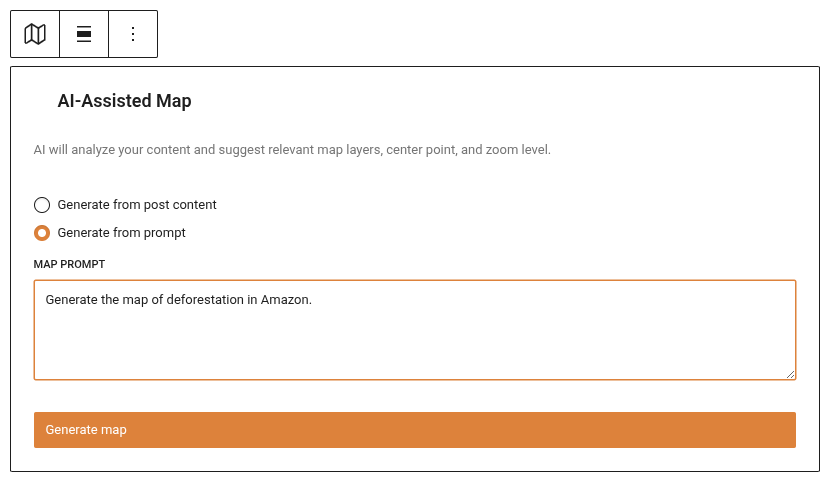
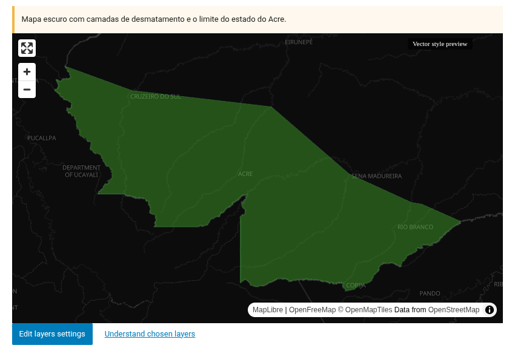
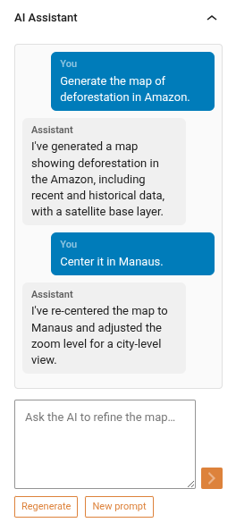
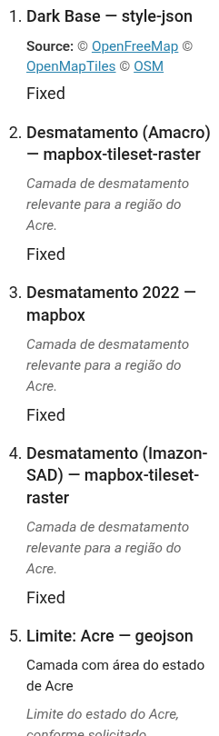

# Minimapa — Bloco de mapa assistido por IA

O bloco Minimapa (`jeo/ai-minimap`) gera mapas interativos contextuais dentro do editor Gutenberg usando IA. Descreva o que você precisa em linguagem natural e a IA constrói um mapa com camadas apropriadas, ponto central, nível de zoom e pinos de geolocalização.

Consulte [IA no JEO](ai-in-jeo.md) para saber como RAG, agentes e ferramentas alimentam este recurso.

## Inserindo o bloco

1. No editor Gutenberg, clique no botão **+** para adicionar um novo bloco.
2. Pesquise por **Minimapa de IA do JEO** e selecione-o.
3. O bloco começa no estado **ocioso** com dois modos de geração:
   - **A partir do conteúdo do post**: gera automaticamente um mapa com base no conteúdo e nos pontos de geolocalização do post atual.
   - **A partir do prompt**: descreva o mapa que você quer em um campo de texto.

## Gerando um mapa

### A partir do conteúdo do post

Clique em **Gerar a partir do conteúdo do post**. O sistema pesquisa suas camadas existentes e os dados de geolocalização do post para construir um mapa contextual. Nenhum prompt de IA é necessário — ele usa RAG (Geração Aumentada por Recuperação) para encontrar camadas relevantes automaticamente.

### A partir do prompt

Digite uma descrição do mapa que você quer (por exemplo, "Um mapa da região amazônica mostrando dados de desmatamento e rios") e clique em **Gerar**. O agente de IA vai:

1. Analisar o seu prompt e o conteúdo do post atual.
2. Pesquisar camadas existentes relevantes na sua Base de Conhecimento.
3. Geocodificar localizações relevantes.
4. Retornar um mapa completo com camadas, centro, zoom e pinos.

## Refinamento por chat

Depois que um mapa é gerado, o bloco entra no estado **pronto**. Um **painel do inspetor** abre na barra lateral do Gutenberg, onde você pode refinar o mapa por meio de chat:

- **Mensagens de texto**: digite instruções como "Aproxime em São Paulo" ou "Remova a camada de água".
- **Regenerar**: comece do zero com uma sugestão de mapa totalmente nova.
- **Novo prompt**: insira uma nova descrição para gerar um mapa diferente (mantém o contexto da conversa).
- **Variante de camada base**: alterne entre camadas base escura, clara e de satélite.

A IA lembra a sua conversa, então cada refinamento se apoia no contexto anterior.

## Entendendo as camadas escolhidas

Já se perguntou por que a IA escolheu uma camada específica? Abaixo da prévia do mapa, clique em **Entender camadas escolhidas** para abrir o painel **Camadas do mapa** na barra lateral do bloco. Para cada camada, você verá:

- **Título e tipo** — por exemplo, "Alertas de desmatamento — mapbox".
- **Descrição** — o resumo da camada, quando disponível.
- **Por que foi escolhida** — a explicação da própria IA para incluir a camada neste mapa.
- **Aviso de estilo automático** — quando a IA precisou aplicar estilo a uma camada que não tinha estilo salvo, para que você saiba que ela pode ser personalizada.
- **Temas e fonte** — os temas da camada e a atribuição dos dados, para desambiguar quando existirem camadas com nomes semelhantes.

## Camadas geradas por IA (Minilayer)

Se você tiver uma chave de API do Mapbox configurada, a IA pode **gerar camadas de mapa personalizadas** quando as camadas existentes não cobrirem o que você precisa. Durante o chat, peça à IA para criar uma camada (por exemplo, "Você pode gerar um mapa de calor de desmatamento da Amazônia?"). A IA pedirá a sua confirmação antes de gerar — ela nunca cria camadas sem aprovação explícita. A nova camada é adicionada ao mapa automaticamente com um estilo sugerido pela IA (cores e filtros) que você pode sobrescrever depois no modal de configurações da camada, por meio da caixa de seleção **"Usar estilo padrão da IA"**.

## Recursos do mapa

Após a geração, o minimapa se comporta como qualquer mapa JEO:

- **Deslocamento e zoom**: arraste para deslocar, role a página sobre o mapa para dar zoom.
- **Camadas**: camadas temáticas com legendas.
- **Pinos**: pinos de geolocalização provenientes dos dados de geolocalização do post. Use o painel **Pinos de geolocalização** (Mostrar pinos: Sim/Não) para controlá-los — eles são renderizados ao vivo na prévia do editor e no frontend.
- **Camada base**: escolhida automaticamente (escura/clara) com base nas cores das camadas, ou selecionada manualmente.

## Requisitos

- Um provedor de IA deve estar configurado em **Jeo → IA** (consulte [Configurações de IA](ai-settings.md)).
- Para melhores resultados, indexe seus posts e camadas na Base de Conhecimento (aba RAG).
- Para camadas temáticas geradas por IA, uma chave de API do Mapbox também é necessária. Camadas de limites (municípios, estados, terras indígenas) são geradas como GeoJSON e funcionam sem uma chave do Mapbox.
