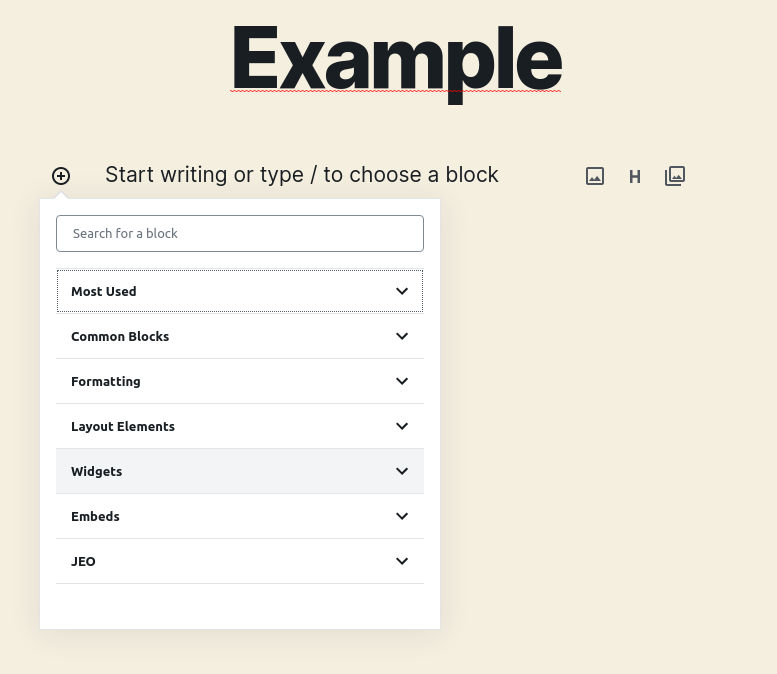
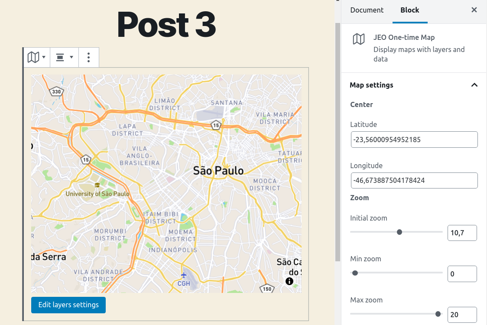

# Bloco de mapa de uso único

É possível usar mapas em posts sem precisar criar um novo mapa nem usar um existente. Para isso, o plugin JEO disponibiliza outro tipo de bloco: o **Mapa de uso único**.

Ao criar um novo post, note que há uma nova categoria de blocos disponível: **JEO**.

Ao selecionar o bloco **JEO One-time Map**, aparecerá uma prévia padrão do mapa. Este tipo de mapa permite todas as mesmas personalizações de um [Mapa JEO](map-post.md) normal, como: modificação de coordenadas, configurações de zoom, posts relacionados, opções de alinhamento e [configurações de camadas](layer-post.md). Para saber com precisão como personalizar todas essas opções, consulte a página do [Mapa JEO](map-post.md).

