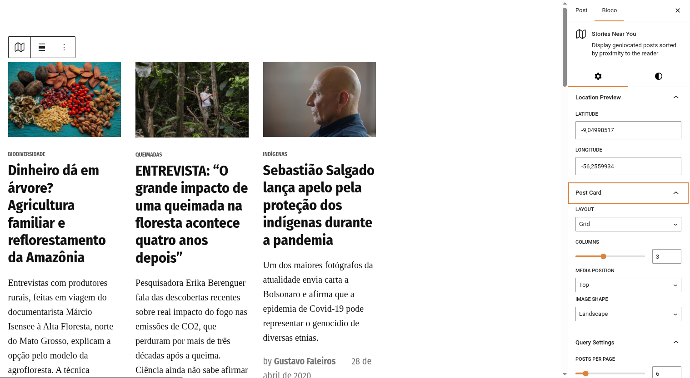
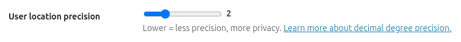
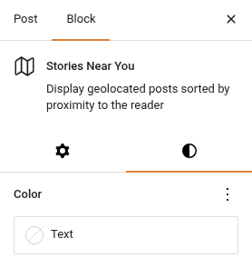

# Histórias próximas a você

O bloco **Histórias próximas a você** (`jeo/stories-near-you`) exibe os posts geolocalizados mais próximos da localização atual do leitor. Ele usa a API de geolocalização do navegador (com consentimento explícito do usuário) para encontrar histórias próximas e as apresenta em um layout de cards personalizável.

## Inserindo o bloco

1. No editor Gutenberg, clique no botão **+** para adicionar um novo bloco.
2. Pesquise por **Histórias próximas a você** e selecione-o.
3. Configure as opções do bloco nos painéis do inspetor.

## Como funciona

Quando um visitante carrega uma página com este bloco:

1. O bloco mostra um **pedido de consentimento**: "Use my location" (usar minha localização) ou "Skip" (pular).
2. Se o usuário consentir, o navegador obtém as coordenadas (arredondadas por privacidade de acordo com a configuração de **precisão da geolocalização**).
3. Se o usuário pular, o bloco recorre ao centro padrão do mapa configurado nas Configurações do JEO.
4. O bloco consulta o banco de dados do WordPress pelos posts geolocalizados mais próximos usando distância geográfica (`ST_Distance_Sphere`).
5. Os posts são renderizados como cards no layout escolhido.

### Precisão da geolocalização

A configuração **Precisão da localização do usuário** (em JEO → Configurações → Geral) controla quantas casas decimais são mantidas da geolocalização do navegador. Intervalo: 1–5, padrão: 2. Valores menores significam menos precisão, mas mais privacidade.

## Configurações do bloco

Os painéis do inspetor oferecem ampla personalização:

### Card de post

- **Layout**: Grade ou Lista.
- **Posição da mídia**: Topo, Esquerda, Direita ou Atrás (a imagem é posicionada atrás do texto).
- **Formato da imagem**: Paisagem, Retrato, Quadrado ou Sem recorte.
- **Colunas**: número de colunas no layout em grade (1–6).

### Configurações de consulta

- **Posts por página**: total de posts a exibir (máx. 36).
- **Tipo de post**: filtrar por tipo de post (exibido apenas se existirem vários tipos com geolocalização habilitada).

### Filtros

- **Categorias**: incluir categorias específicas.
- **Tags**: incluir tags específicas.
- **Exclusão de categorias**: excluir categorias específicas.
- **Exclusão de tags**: excluir tags específicas.
- **Taxonomias personalizadas**: filtrar por termos de taxonomias personalizadas.

### Exibição

- **Miniatura**: mostrar/ocultar a imagem destacada.
- **Categoria**: mostrar/ocultar o selo de categoria.
- **Data**: mostrar/ocultar a data de publicação.
- **Resumo**: mostrar/ocultar o resumo (com contagem de palavras configurável).
- **Autor**: mostrar/ocultar o nome do autor.
- **Avatar do autor**: mostrar/ocultar a foto do autor (requer Autor habilitado).
- **Ler mais**: mostrar/ocultar o link "Ler mais" (com rótulo personalizado).

### Tipografia e espaçamento

- **Escala tipográfica**: escala do tamanho da fonte (1–10).
- **Escala da imagem**: largura da imagem em layouts horizontais (1–4).
- **Espaço entre colunas**: espaçamento entre colunas (pequeno, médio, grande).
- **Altura mínima**: altura mínima para o layout "Atrás".

### Cores

As cores do texto e dos links usam as configurações nativas de cor do Gutenberg (não há um painel separado).

## Deduplicação entre blocos

Quando vários blocos Histórias próximas a você estão na mesma página, os posts **nunca se repetem** entre os blocos. O primeiro bloco mostra os posts mais próximos, o segundo mostra os próximos mais próximos (excluindo os posts do primeiro bloco) e assim por diante.

Isso funciona tanto na prévia do editor quanto no frontend.

## Compatibilidade com o Newspack

Se o plugin [Newspack Blocks](https://newspack.pub/) estiver ativo, o bloco usa automaticamente os templates e estilos de card do Newspack para uma integração visual perfeita com o seu tema Newspack.

## Requisitos

- Os posts devem estar geolocalizados (ter o metadado `_related_point`). Consulte [Geolocalização de posts](geolocating-posts.md).
- O centro padrão do mapa do JEO deve estar configurado em **Jeo → Configurações** (usado como fallback quando o usuário não compartilha sua localização).
