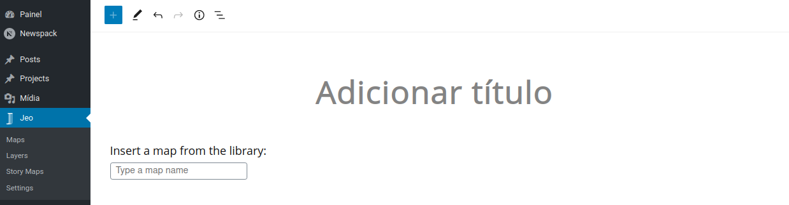
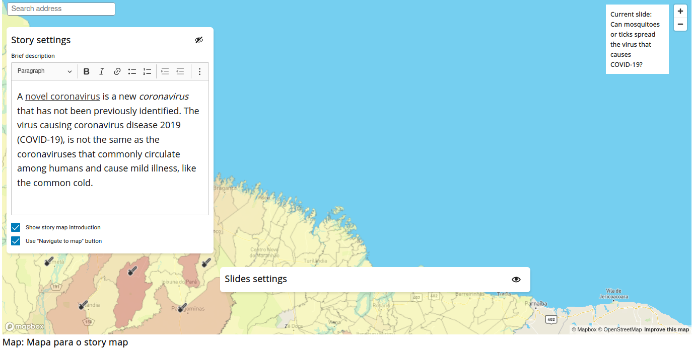
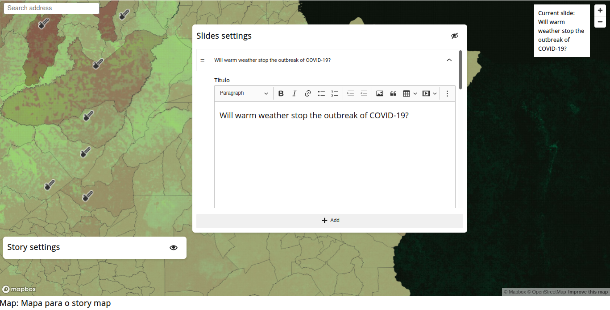
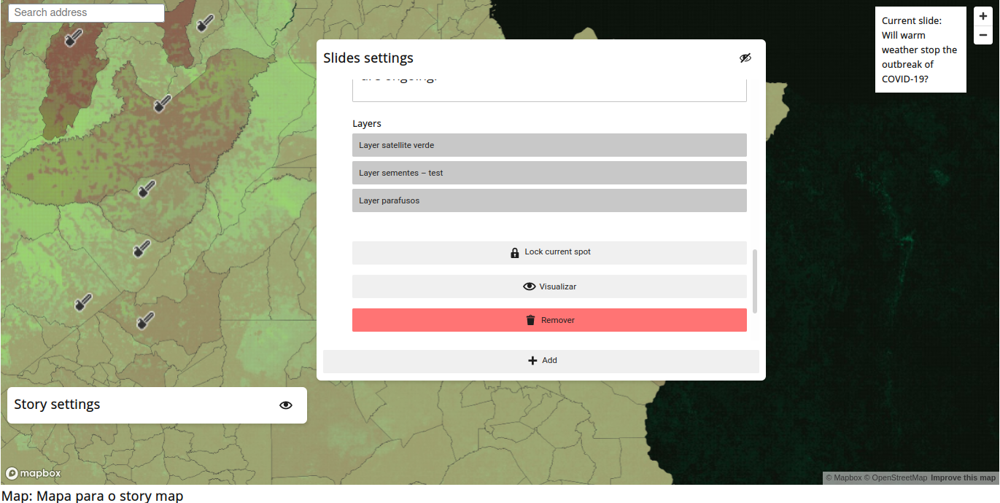
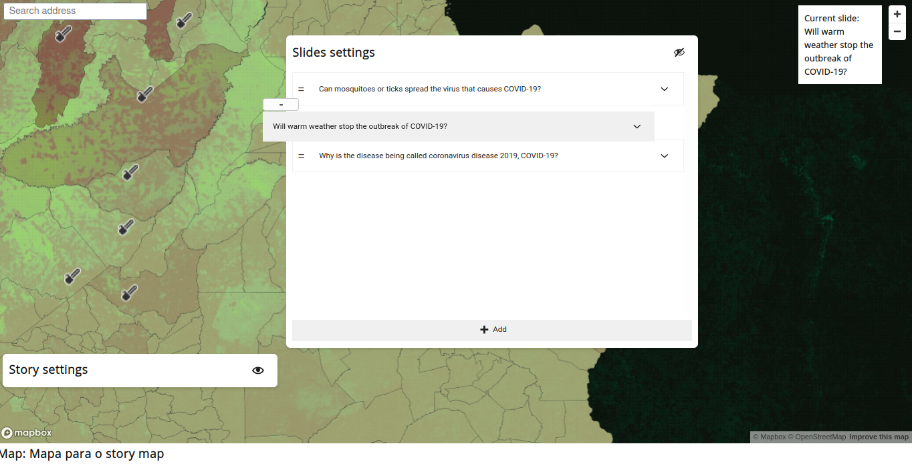
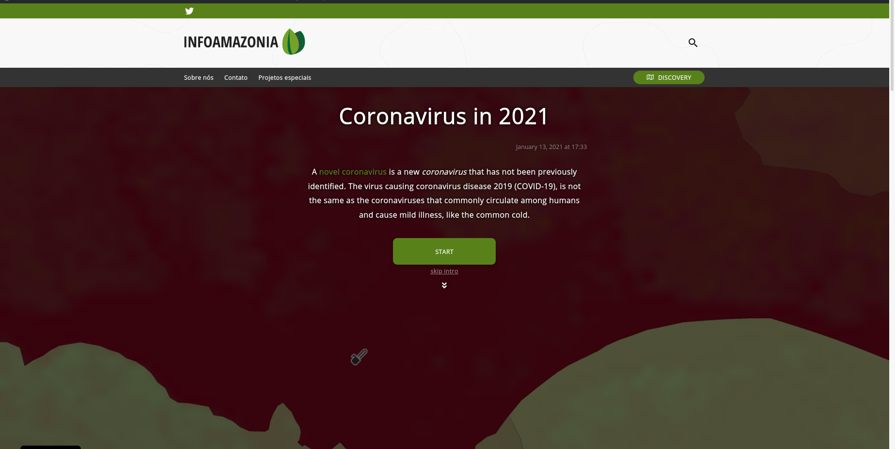
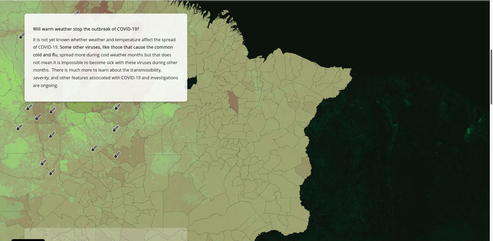
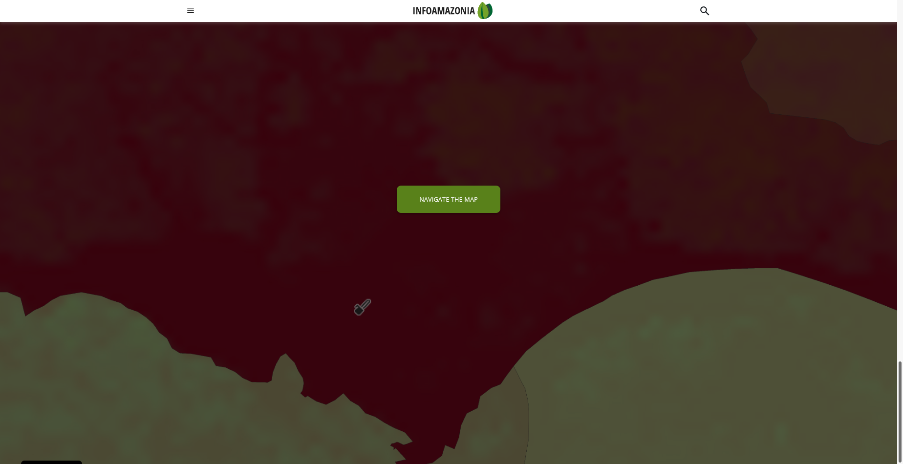
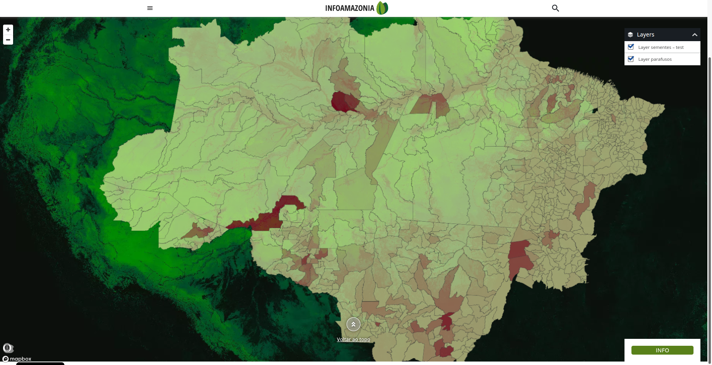

# Mapa Narrativo

O Mapa Narrativo é uma forma de criar uma narrativa interativa com mapas e camadas personalizados. Você pode selecionar localizações específicas e associar camadas e textos a essas localizações. Isso gera um mapa que, conforme a página é rolada, muda de uma localização/camada/texto para outra. Esse conjunto de localização, camada e texto é chamado de **Slide**.

## Criando um Mapa Narrativo

O Mapa Narrativo é um tipo de post personalizado no plugin JEO. Ao criar um, será solicitado um mapa. Todas as camadas que você usará no seu Mapa Narrativo vêm desse mapa selecionado anteriormente. Além disso, o Mapa Narrativo possui uma `função de navegação`, que abordaremos mais adiante. Essa função de navegação também usa esse mapa selecionado para funcionar.



### Configurações da narrativa

Aqui você pode definir uma descrição para o seu mapa narrativo, que será exibida no início do post, junto com o título e a data de publicação. Você também pode definir se o seu mapa narrativo terá uma introdução e um `botão de navegação do mapa`.

**Todos os campos de texto têm um editor de texto rico integrado. Isso significa que você pode inserir texto em negrito, links, listas, etc. dentro do seu campo de texto.**

O `botão de navegação do mapa` aparece no final de um Mapa Narrativo e permite ao usuário navegar pelo mapa. Esse mapa seguirá todas as configurações do mapa selecionado anteriormente.



### Configurações dos slides

Um slide do Mapa Narrativo contém um título, um conteúdo, uma localização e as camadas selecionadas (a ordem das camadas sempre seguirá a ordem das camadas do mapa definida quando ele foi criado). Você pode remover um slide clicando no botão **Remover**, pré-visualizar o mapa de um slide clicando no botão **Previsualização** e definir a localização do slide atual clicando no botão **Marcar ponto atual**. Você pode ver qual é o slide atual no canto superior direito do bloco.

Você pode escolher a localização de um slide arrastando o mapa com o botão esquerdo do mouse e ajustar sua inclinação (pitch) e orientação (bearing) arrastando o mapa com o botão direito do mouse.





Os slides podem ser reordenados clicando no ícone `=` e arrastando-o para posicionar o slide em outro lugar.



## Visualizando um Mapa Narrativo

É assim que um Mapa Narrativo fica em um post:



Ao clicar em **INICIAR**, o usuário será levado ao primeiro slide. Ao clicar em **pular introdução**, o usuário será levado ao próprio mapa para poder navegar por ele (este botão só está disponível se a configuração de navegação estiver habilitada nas configurações do mapa narrativo). Esses botões, o título, a descrição e a data de publicação só aparecem se `Mostrar introdução do mapa narrativo` estiver habilitado. Caso contrário, o mapa narrativo começa no primeiro slide.



Conforme a página é rolada, o slide atual muda para o próximo e o mapa faz uma transição para a próxima localização e troca suas camadas. Ao final da narrativa, se a configuração correta estiver habilitada, um botão **Navegar no mapa** aparecerá. Ao clicar nele, o usuário será levado ao próprio mapa e poderá interagir com ele.





## Integração com temas

A saída pública do mapa narrativo inclui um contêiner de mapa estável para integrações com temas:

```html
<div class="story-map-element jeo-storymap-map js-jeo-storymap-map"></div>
```

Temas que precisam posicionar ou medir o mapa narrativo devem mirar `jeo-storymap-map`
ou `js-jeo-storymap-map` em vez de classes de runtime como `mapboxgl-map` ou
`maplibregl-map`. As classes do JEO estão presentes antes de o runtime do mapa ser
inicializado, enquanto as classes de runtime são adicionadas de forma assíncrona
pela biblioteca de mapas.
